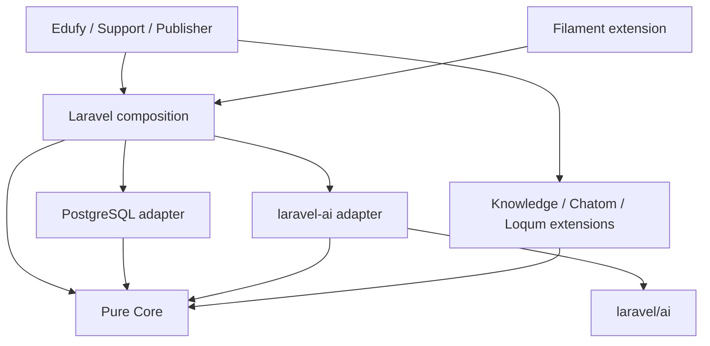

# AgenTools: единая платформа вместо AgenTools и Botkit

Вход для будущего плана Opus. Выводы диалога сведены без повторов; это не план исполнения и не подтверждение реализации. Общие поправки и зависимости: [Edufy-Ecosystem-Audit-Map-2026-10-30](../../../../edufy/audits/2026-10-30-ecosystem/00-ECOSYSTEM-MAP.md).

## Решение для следующего плана

**Botkit больше не развивается как отдельный пакет/платформа.** Его полезные механизмы переходят в AgenTools. Внутри одной платформы сохраняются две ответственности:

- Assistant Runtime: профиль → разрешённый контекст → model loop → tool proposals → ответ.
- Action Runtime: конкретная операция → confirmation → исполнение/эффект → статус/reconcile/recovery.

Одна документация, согласованный комплект версий и основной репозиторий; embedded-вызовы в Laravel по умолчанию. Не требуется сетевой сервис на каждый action. Никаких параллельных LLM-планировщиков для одного запроса.

Это направление владельца и финальный RFC диалога. Перенос ещё не выполнен. Действующий [Ecosystem-Canon](../../../../../Vaults/Brain/Infrastructure/Canon/Ecosystem-Canon.md) описывает AgenTools как action protocol, Botkit как runs/jobs/schedules: обновление этих границ надо провести отдельным ADR в будущем плане.

## Что подтверждено локально

- AgenTools checkout `618c37644ce9`: protocol-first spec `2026-09`, frozen predecessor `2026-08`, отдельный MCP pin `2026-07-28`, PHP/Dart SDK и conformance. README указывает private/proprietary и release owner gate; новую публичную установку нельзя считать доступной.
- Текущий PHP package — `agentools/sdk`, namespace `AgenTools\`, PHP `>=8.3`. Это не целевой `axioma/agentools-core` из RFC.
- Botkit checkout `59c701335f31`: DB-centric assistant infrastructure поверх `laravel/ai`; README требует PHP `^8.4`, Laravel `^13.0`, `laravel/ai ^0.6`. Есть definitions, managed pipeline, plugins, fakes, cadence и Filament packages. Это прочитанное описание и manifests, не выполненный аудит всех execution paths.
- В Brain control towers и Canon сохранились ранние границы. Полного кода/тестового/provider аудита эта раскладка не заменяет.

## Пакетный состав RFC

Названия ниже проектные, не выпущенные пакеты; окончательные namespace, лицензия и release policy — результат инвентаризации.

| Базовый комплект | Роль |
|:--|:--|
| `axioma/agentools-core` | Независимые от framework Profiles/Context/Models/Runtime/Actions/Security/Common |
| `axioma/agentools-postgres` | Production persistence, transactions, projections, inbox/outbox, claims |
| `axioma/agentools-laravel-ai` | Проверенный мост к конкретной версии SDK |
| `axioma/agentools-laravel` | Composition/service providers, scoped context, jobs, commands, opt-in HTTP |
| `axioma/agentools-testing` | Fakes, fixtures, faults и conformance без обхода guards |
| `axioma/agentools` | Метапакет совместимой стандартной установки без бизнес-логики |

Опциональные extensions: Knowledge, Chatom, Loqum, Filament, Evaluation, Scheduler. Не выделять сразу отдельные packages для profiles/skills/memory/routing/token budget/confirmations/usage/outbox/security. Деление оправдывается независимой установкой, зависимостями и реальными потребителями.

Core не импортирует Laravel/Eloquent, DB/Redis/HTTP/SDK, Chatom/Loqum/Filament/Edufy. Runtime координирует независимые внутренние модули; Actions не импортирует Runtime и не запускает второй assistant loop. Host domain models/container не проходят в core.

Полное исходное дерево, таблицы и примеры: [AgenTools-04-Technical-Reference-2026-10-30](AgenTools-04-Technical-Reference-2026-10-30.md). Это перечень обязанностей и исходных предложений, не требование немедленно создавать все пустые классы.

## Что перенести и что сохранить

| Источник | Полезное | Обязательная переработка/проверка |
|:--|:--|:--|
| Botkit | Definitions, instance configuration, managed pipeline, plugins, SDK bridge, fakes, cadence, UI/read models, observability | Draft→publish вместо изменения активной конфигурации; headless services отдельно от Filament; mandatory guards отдельно от plugins; raw path не равен managed |
| AgenTools | Protocol/schema, native SDKs, conformance, lifecycle/journal, confirmation, effect tracking, recovery | Сохранить межъязыковые семантики и используемые обязательства; новый integration protocol не подменяет существующую dated spec |
| Host | Business facts, permission/consent, официальные документы, деньги, gold/scorers | Общая платформа получает разрешённые данные и вызывает публичные owner contracts |

Нельзя из отсутствия `spec/`, `fixtures/`, `conformance/`, `php/`, `dart/` в новом PHP-дереве сделать вывод об их удалении. Offline-first Dart/AiResto и независимые actions без ассистента остаются требованиями, пока их потребители не проверены. PHP modular platform не должен превращаться в обязательное облачное ядро для этих сценариев.

## Чистое ядро и расширяемость

Обязательные инварианты: стабильные IDs; кодовая регистрация definitions/handlers; published immutable; запреты поверх bundle; trusted context; отсутствие IO под SQL lock; unknown отдельно; отмена ответа не отменяет эффект; без второго transcript; NULL/unknown usage не равен 0.

БД не подключает произвольные PHP-классы, URL/SQL или tools по текстовому указанию. Типы/selectors/extensions регистрируются кодом. Фреймворк только связывает реализации портов.

Применить по назначению: hexagonal boundaries, modular monolith, Run/Action FSM, action journal, outbox/inbox, optimistic concurrency, leases/fencing, Strategy, Registry, immutable bundles, SDK anti-corruption layer, умеренный CQRS и capability negotiation. Не вводить event sourcing для всех таблиц, BPM заранее, сервис на namespace, repository на value object, BaseManager/service locator или универсальный `execute(array): array`.

## Где проходит совместимость с SDK

Один `ActionDefinition` даёт execution/model/admin views. Assistant показывает только пересечение registered tools ∩ profile ∩ skill ∩ host permissions ∩ session restrictions ∩ operational availability. Model callback сам не совершает эффект.

До реализации проверить: позволяет ли точная версия `laravel/ai` получить proposals и контролируемо передать tool execution в Actions. Варианты при ограничении: документированный external-tools режим; явно SDK-owned loop с durable callbacks/recovery; отдельный transport. Одновременно два loop запрещены. Не патчить vendor скрытно, не использовать reflection/internal API и не выдумывать методы SDK.

## Результат, нужный Opus

Подготовить evidence matrix «функция → исходный файл/символ → caller/данные → тест → независимый потребитель → целевой модуль → сохранить/адаптировать/удалить». Проверить loop, registry, confirmation, run state, retries/recovery, streaming/UI, model adapters, logs, tenant reset, cadence и custom build/raw routes.

Планируемые блоки из исходника сохранить как кандидаты: A inventory; B core/contracts; C persistence; D минимальный loop; E durable actions; F перенос Botkit; G profiles/context; H Edufy+Chatom; I knowledge/providers/cache; J voice/operations. Порядок отдельных PR Opus определит по реальному коду, без механического переноса всего дерева.

Первый доказанный срез: pure core → PostgreSQL → проверенный model adapter → один read tool → durable response/usage/recovery. Затем confirmation/write, профили/knowledge/providers и голос. Второй host support/editor проверяет универсальность без школьных сущностей.

Удалять подтверждённые дубли только после карты потребителей и проверки замены. Не менять одновременно namespace, протокол, persistence и поведение без управляемой миграции/rollback. Старый и новый runtime не обслуживают один запрос параллельно.
