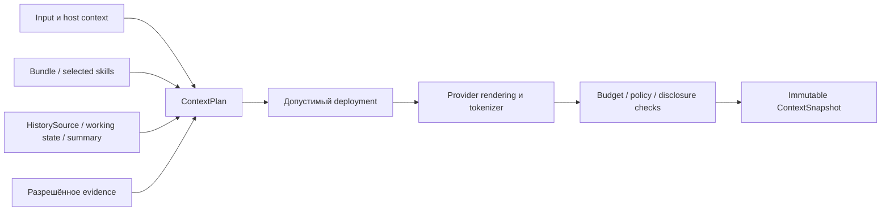

# AgenTools: профили, контекст, память и Knowledge

Вход для будущего плана Opus. Выводы диалога сведены без повторов; это не план исполнения и не подтверждение реализации. Общие поправки и зависимости: [Edufy-Ecosystem-Audit-Map-2026-10-30](../../../../edufy/audits/2026-10-30-ecosystem/00-ECOSYSTEM-MAP.md).

## Сущности и публикация

Разделить Model, ProviderAccount/Deployment, AssistantDefinition/Instance, ProfileVersion/Bundle, SkillVersion/MethodologyPack, KnowledgeCollection/Release, ExecutionPolicy. Профиль описывает поведение и ссылки; deployment — endpoint/model revision, регион, credentials scope, capabilities, цена и quota. Профиль не копирует книги и не выдаёт права.

Published версии неизменяемы: draft → validation/review → published → deprecated → retired. Bundle фиксирует compiler version, hashes и provenance всех зависимостей. Instance назначает bundle новым сессиям. Активные сессии пиннят версии; миграция явная. Security/emergency/revoke проверяются независимо от pinning.

Глобальная база поставляется trusted code/registry; tenant хранит назначение и свой overlay/bundle. Нельзя использовать профиль другого tenant как случайного родителя или `tenant_id=NULL` как неявный control plane.

## Типизированная композиция

| Поле | Merge rule |
|:--|:--|
| Запреты | Union |
| Регионы и допустимые deployments | Intersection ограничений |
| Tools | Intersection с profile/skills/host/session/availability |
| Confirmation | Только усиление floor |
| Методика | Один совместимый pack либо разрешённая явная композиция |
| Материалы | Явное добавление/исключение с актуальной проверкой прав |
| Стиль | Ограниченное переопределение |
| Budget | Не выше разрешённого host limit |
| Safety | Tenant/lesson не ослабляет |
| Emergency block | Поверх опубликованной конфигурации |

Неразрешимый конфликт возвращается объяснимой ошибкой с источниками полей. Не склеивать противоречивые инструкции для разрешения моделью. Defaults, editable settings, security constraints и operational overrides — разные слои, не один options array. Locked model preference не отменяет emergency block.

## Skills

Manifest: id/version/purpose/triggers, required context, allowed tools, prompt fragment refs/hashes, rubrics, token budget, safety class, compatibility и eval refs. Router получает короткие manifests, выбирает небольшой набор; полный текст загружается после выбора. Публикация через eval/canary.

Skill не содержит всю программу, книги, историю, каталог tools или секреты. Педагогические и предметные инструкции — host packs; механизм registry/selection — общий.

## Двухфазный Context Compiler

Compiler один для текста и голоса. Host providers дают необходимые разрешённые slices; прямые импорты students/journal/lessons/guardianships запрещены. План сначала независим от provider, финальная сериализация зависит от API/tokenizer/capabilities.

ContextBlock: kind/source/source_version/owner, trust_class, classification/sensitivity, purpose, priority, content_ref/hash, freshness/expiry, mandatory и evidence refs. Модель не назначает trust и не повышает полномочия текстом из history/book/tool/summary/memory.

Порядок секций-кандидат: обязательная policy → стабильный profile → selected skills → tools → цель/working state → subject slice → evidence → summary → recent exact turns → input. Provider adapter может менять layout по документированному API.

Snapshot/manifest хранит bundle/skills/policy hashes, summary version, source message IDs, domain versions, fragment/material/corpus refs, deployment/routing decision, model params, tokenizer/renderer/compiler versions, token report, исключённые данные и причины, cache refs, trace/run IDs и retention. Полный rendered prompt — только ограниченный encrypted diagnostic payload, не бессрочный архив ПД.

## Токены и результаты tools

`input budget = context window − output reserve − safety margin`. До вызова посчитать tokenizer выбранной модели. Никогда молча не обрезать массив сообщений.

Приоритет: mandatory policy и текущая реплика → цель/working state/open promises и обязательные skills → recent exact turns/evidence → summary/episodic memory → примеры. Сначала убирать дубли и нерелевантное, затем необязательные детали. Если mandatory часть не помещается — объяснимый отказ/контролируемая смена плана, а не снятие ограничений.

Budget report показывает available/used по policy, skills, state, history, evidence, memories, tools/input и dropped counts/reasons. Числа исходных примеров не целевые лимиты.

Один tool result имеет raw_result_ref, model_view, user_view, audit_view, evidence/freshness. Модели передавать минимальное model_view, не сотни строк owner-таблицы. Tools вне allowlist вообще не сериализуются.

## Память и история

| Слой | Правило |
|:--|:--|
| Transcript | У внешнего HistorySource, в Edufy — Chatom |
| Working state | Текущая цель/шаг/вопрос/последний result/UI ref/обещание |
| Versioned summary | Covered/understood/uncertain/open_questions/promises/artifact/action refs и through_turn |
| Episodic memory | Через внешний MemorySource и релевантный retrieval |
| Business knowledge state | Принимается доменным владельцем, не общим summary engine |

Recent window выбирается по budget/релевантности. Сохранить точный текущий вопрос, последнюю задачу/обещание/уточнение/tool result/active object.

Иерархия: exact turns → segment summaries → session summary → episodic memories. Summary запускать по threshold, завершению сегмента, смене темы/сессии/model; не каждый turn. Периодически перестраивать/проверять по исходным refs, не бесконечно суммировать summaries.

Memory candidate: type/value, subject, sources, extractor, confidence, sensitivity, valid/expiry/confirmation dates, retention/status. Lifecycle: допустимость хранения → sensitivity → dedup/evidence → host acceptance при необходимости → activation → revalidation/confidence decay → expiry/revoke/delete.

Первый runtime ограничить working state, versioned summary, history selection и внешним MemorySource. Большой автономный memory engine не нужен. В Edufy observations принимаются AiCore; диагнозы/эмоции/секреты/данные третьих лиц не запоминаются автоматически.

## Knowledge extension

Опциональный пакет: DocumentSource/Extractor/Validator, MaterialAccessPolicy, KnowledgeRepository, SearchIndex/EmbeddingTransport; материал/version/nodes/fragments/cards/corpus/releases/processing/validation/dependencies. OCR/PDF engines — адаптеры, не зависимости core.

Универсальный lifecycle: source ref/rights → extraction/структура/координаты → fragments + navigation summaries + knowledge cards → validation → release → retrieval → correction/invalidation. Предметные формулы, возраст, учебные standards/prerequisites и answer keys проверяет Edufy extension.

Hybrid retrieval: metadata/tenant/audience/version/locale/program filters до выдачи → lexical + semantic → rerank → diversity/dedup overlaps → минимальный достаточный fragment → source metadata → повторная проверка перед раскрытием. Retrieval result — evidence run, не автоматическая memory.

Embeddings хранят model/revision/dimensions/normalization/index version; разные пространства не смешиваются. Размерность не зашивается в общий domain contract.

Каталог Knowledge может быть технической проекцией внешнего Library с owner/access_policy refs; не второй владелец лицензий. Bytes/крупные derivatives — Files/Vaulter через refs. Детальные поля и дерево — [AgenTools-04-Technical-Reference-2026-10-30](AgenTools-04-Technical-Reference-2026-10-30.md).

## Инвалидация и cache

Dependency graph: material → fragments/cards → release → bundle → context snapshots → cache artifacts; message → summary/candidates/history index/context caches. Коррекция/удаление делает производную версию непригодной для новых runs. Исторический run маркирует отозванный/исправленный источник, не переписывает историю.

Различать compiled artifact, context fragment, retrieval, implicit provider, explicit provider cache и provider-managed conversation. Последняя — не переносимая память. Retrieval key включает tenant, permission scope, corpus/topic/locale/curriculum/query normalization; доступ перепроверяется, cache не выдаёт grant.

Warm pack перед voice: profile slice, lesson, skill shortlist, knowledge state, summary/recent turns и tools. На turn — новая реплика/context delta, не весь чат. Правила provider cache и экономику см. [AgenTools-05-Models-Cache-Operations-2026-10-30](AgenTools-05-Models-Cache-Operations-2026-10-30.md).
