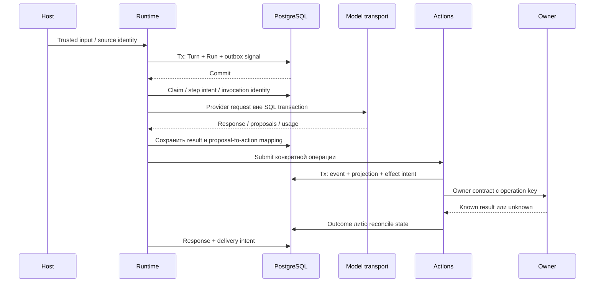

# AgenTools: исполнение, эффекты, подтверждения и recovery

Вход для будущего плана Opus. Выводы диалога сведены без повторов; это не план исполнения и не подтверждение реализации. Общие поправки и зависимости: [Edufy-Ecosystem-Audit-Map-2026-10-30](../../../../edufy/audits/2026-10-30-ecosystem/00-ECOSYSTEM-MAP.md).

## Идентичности и состояния

AssistantDefinition → Instance → immutable ProfileBundle → AssistantSession → Turn → Run → ModelInvocation. Run содержит tool proposals, ссылки на Actions/Effects и Deliveries; EducationSession и RealtimeSession внешние.

Turn — устойчивый принятый ввод; Run — исполнение реакции с checkpoints и ожиданиями; Invocation — один provider request. Один turn не получает новую реплику при retry; первая версия допускает один активный Run на Turn. Новый контролируемый Run хранит историю, fallback создаёт отдельную Invocation.

Run: accepted → preparing → running; ожидания action/confirmation/external, cancelling; terminal completed/failed/cancelled. Состояние доставки отдельное: completed не означает delivered.

Action: pending → rejected / awaiting_confirmation / ready → executing → succeeded / failed / reconciling / cancellation_requested. Reconcile → known success/failure либо manual_resolution_required. Эти состояния RFC надо сопоставить с текущей dated spec, а не заменить протокол автоматически.

## Durable приём и orchestration

Queue job — сигнал, не источник истины. Scanner находит committed незапущенные runs. AdvanceRun: claim → определить шаг → записать intent → external IO → сохранить result/checkpoint → продолжение. Не держать процесс только в памяти одного огромного job.

Перед provider call: routing и emergency check, final snapshot, budget admission, Invocation persist. После ответа: persist response/usage/proposals, stable proposal→action mapping, затем эффекты. Один повтор submit возвращает ту же операцию; тот же source/message key с другим payload hash — конфликт целостности.

Лимиты: deadline, invocations/tools, одинаковые ошибки, tokens/cost, read parallelism, cancellation. Точный model output недетерминирован: нельзя повторным LLM-вызовом «восстановить» уже принятое решение.

## Единый каталог и лёгкие операции

ActionDefinition: id/version/hash, input/output schemas, owner/handler binding, effect class, confirmation/scopes, timeout/retry/idempotency/deadline, cost/residency/retention/redaction/compensation/audit. Зарегистрирован кодом; execution/model/admin views — производные одного определения.

Не вся функция требует тяжёлого durable lifecycle: token count/schema validation/local selection — код; разрешённый read slice — лёгкий tool с нужным аудитом; книга — resumable process; document/send/money — контролируемый action/effect. Класс определяется стоимостью и риском раскрытия/изменения, не именем `get`.

Action handler может использовать общий model transport для ограниченной задачи. Это не второй универсальный assistant planner. Длительную подзадачу можно явно делегировать владельцу workflow; родитель хранит process reference и не планирует те же шаги параллельно.

## Три границы проверок

- Assistant проверяет allowlist, schema и допустимость постановки предложения.
- Actions проверяет contract/lifecycle, confirmation, идентичность, безопасный retry и необходимость reconcile.
- Owner проверяет текущие права и бизнес-инварианты и пишет собственный факт.

Confirmation связано с tenant/actor/action/definition version/input hash/scope hash/policy version/expiry/proof. Изменение получателя, документа, суммы или payload требует нового решения. Текст модели «пользователь согласился» не proof. Голосовое решение должно быть привязано к конкретному preview по принятой политике.

Confirmation не заменяет актуальную owner-авторизацию; revoke между check и write закрывается у владельца. Авторизация, consent и финансовые полномочия не становятся собственностью runtime.

## Effect boundary

У Action могут быть отдельные Effects со stable effect_key, owner_operation_ref и точным request hash. До external call сохраняется intent, после — known outcome. Потерян ответ → запрос owner status по operation key; не новый эффект, не смена модели ради повторной записи.

Без owner lookup/idempotency гарантия ниже: отдельная reconciliation strategy, unresolved/manual queue, запрет слепого повтора опасной операции. Exactly-once произвольного внешнего API не обещается.

Lease распределяет работу; fencing защищает принятие поздней локальной записи. Сам по себе локальный fencing не останавливает external effect старого worker: нужен owner operation contract. Истёкший lease не даёт разрешение повторить действие.

Run cancellation и Action cancellation — запросы с отдельными исходами. Остановка stream/TTS не отменяет уже исполненное действие; компенсация — отдельная разрешённая операция, если она предусмотрена владельцем.

## Хранение и транзакции

- Actions: append-only journal — каноническая история; current row — projection. Event + projection + outbox атомарны.
- Runs/sessions: версионированное состояние и checkpoints; event sourcing для всех таблиц не требуется.
- Run step хранит action ref и ожидание, не копию action journal.
- Основной production adapter RFC — PostgreSQL; in-memory — тестовый профиль. Чувствительные payloads через refs/encryption/retention, без transcript-копии.
- Tenant-scoped PK/FK `(tenant_id,id)`, optimistic versioning, uniqueness source event/proposal/action/effect/delivery/occurrence; RLS только после проектирования pool/job context и привилегий. FK не заменяет read authorization.

## Потери и деградация

| Точка | Ожидаемое поведение |
|:--|:--|
| Turn commit → потерян job | Scanner запускает тот же Run |
| Provider отправлен → response потерян | Invocation unknown, возможная стоимость учтена; lookup при наличии либо отдельная контролируемая Invocation |
| Proposal persist → action submit прерван | Один stable Action для этого proposal |
| Effect intent → owner reply потерян | Reconciliation, без повторного эффекта и premature budget release |
| Owner success → local commit потерян | Восстановить по owner operation key |
| Response persist → Chatom недоступен | Durable delivery с тем же key |
| Chatom доставил → receipt потерян | Destination dedup/lookup восстанавливает receipt |
| Confirmation → revoke → execute | Owner отклоняет запись |
| Lease expired → старый worker жив | Поздняя локальная запись отклоняется; external повтор блокируется owner identity |
| Retrieval недоступен | Ограниченный ответ или явный отказ, без выдуманного evidence |
| Skill обновился | Пин старая версия; emergency/revoke действуют сейчас |
| Context revision stale | Reject/update свежим snapshot |
| Voice final повторён/reconnect | Utterance dedup, та же работа и действия |
| Barge-in | Delivered portion/interrupted; не считать весь generated текст услышанным |
| Consent revoke | Остановить запрещённые recording/memory/export, применить owner policy |
| Loqum отключился | Техническая/учебная сессия продолжается текстом |

## Вход Opus

Зафиксировать submit/status/cancel/reconcile semantics, error taxonomy, operation/proposal keys, failure matrix, event schemas, projection rebuild и migration/rollback. Сверить существующие PHP/Dart fixtures; отделить подтверждённые свойства от новых требований.

Доказательства: unit FSM/merge/confirmation; contract repositories/transport/delivery; реальная PostgreSQL concurrency/rollback/outbox/claims/tenant FK; end-to-end recovery и opt-in provider tests. Fake заменяет внешнюю зависимость, сохраняя guards/lifecycle. Fake-only PASS не равен production readiness.
