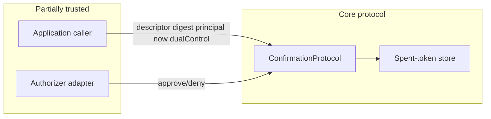
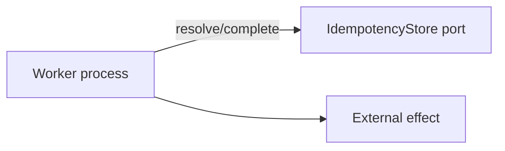
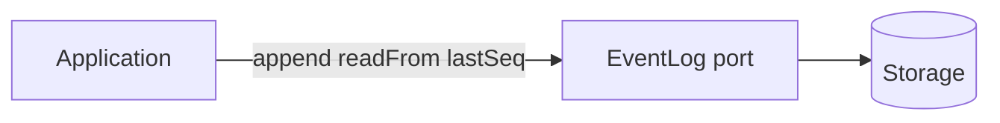

# Threat model v1 — AgenTools hardening (PLAN1)

**Version:** v1  
**Status:** draft contract (P1.2)  
**Evidence date:** 2026-09-20  
**Baseline anchor:** `artifacts/P1-baseline.json` @ commit `8ce43f47735d827be3872bcb8c01d09dd38ed22d`

This document freezes trust boundaries, security/durability data flows and misuse cases for remediation
phases P2–P10. It does not choose final crypto formats, storage DDL or release policy.

## 1. Assets and security objectives

| Asset | Objective |
|:--|:--|
| Confirmation tokens and approval decisions | Integrity, single-use spend, binding to descriptor and principal |
| Idempotency leases and effect outcomes | Safety under crash/restart; no duplicate external effects |
| Event log entries and journal chain | Durability, ordering, tamper-evidence, tenant isolation |
| Tool descriptors and argument payloads | Integrity at execution boundary; no confused-deputy execution |
| Package archives and public API surface | Predictable consumer contracts (owned by P7/P10) |

## 2. Actors and trust zones

| Zone | Examples | Trust |
|:--|:--|:--|
| **Trusted runtime core** | Spec validators, canonicalization oracles, conformance harness when run in CI | Trusted only inside declared scope |
| **Partially trusted integrator** | Application caller supplying `now`, principal, authorizer, policy adapters, in-memory stores | Partially trusted — inputs must be validated and never silently promoted |
| **Untrusted remote/tooling** | MCP peers, network transports, persisted blobs from other tenants, replayed requests | Untrusted — assume malicious where bytes cross a boundary |
| **Operator / CI** | GitHub Actions, release operators | Trusted for supply-chain evidence (P9), not for end-user authorization |

Application integration code and tool/policy adapters are **partially trusted**, not trusted.

## 3. Data flows (security/durability)

### 3.1 Confirmation (descriptor → proposal → token → approval → commit)

### 3.2 Idempotency (acquire → effect → complete)

Current ports lack acquire/lease/fencing; crash window is an open durability gap (TM-004).

### 3.3 Event append/load

Batch append, expected-version and collision semantics are not yet contractually enforced (TM-005).

## 4. Threat and misuse catalog

Terms **secure** and **exactly-once** appear only with explicit scope and negation where applicable.

| ID | Finding | Asset / entry | Prerequisite | Impact | Current disposition | Owner | Proof type |
|:--|:--|:--|:--|:--|:--|:--|:--|
| TM-001 | F01 Caller-controlled confirmation context | Confirmation commit boundary | Permissive caller supplies `now`, principal, authorizer, dual-control flags | Policy bypass, replay within TTL window | open | P2 | Negative tests on untrusted caller inputs; trusted clock/identity seam |
| TM-002 | F02 Process-local spent-token state | In-memory spent map | Process restart or second instance | Token replay across processes | open | P3 | Durable atomic consume evidence |
| TM-003 | F03 Weak binding of approval to proposal/trusted context | Authorizer + proposal path | Mismatched or permissive authorizer | Unauthorized commit | open | P2 | Integration tests denying by default |
| TM-004 | F04 Idempotency without lease/fencing | IdempotencyStore | Crash between resolve and complete | Duplicate or lost effects (not exactly-once scoped to port) | open | P4 | Crash/restart schedules; fence tokens |
| TM-005 | F05 EventLog lacks atomic batch/collision contract | Event append | Concurrent writers | Lost updates, torn batches | open | P5 | Storage-level collision and pagination proofs |
| TM-006 | F06 Token envelope gaps | Token bytes on wire | Weak or ambiguous fields | Cross-tenant/purpose confusion | open | P3 | Versioned envelope + negative vectors |
| TM-007 | F07 Error/JCS parity gaps | Cross-language fixtures | Divergent serializers | Silent semantic drift | open | P6 | Machine-readable error registry + JCS oracle gate |
| TM-008 | F08 MCP vs Agentools conformance scope | Conformance reports | Treating internal greens as official MCP | False compliance claims | open | P6 | Applicability matrix + upstream receipts |
| TM-009 | F09 Accidental public/package surface | PHP PSR-4 reachability, Dart barrels | Wide exports + in-memory types in archives | Unsupported consumer dependencies | open | P7 | Intentional API manifest + archive boundary tests |
| TM-010 | F10 Missing adversarial/resource proof | Test suites | No mutation/fuzz/perf baselines | Regressions undetected | open | P8 | Property/fuzz/crash gates calibrated to P1 baseline |
| TM-011 | F11 CI/supply-chain insufficient for production release | GitHub workflows | Unpinned/unattested pipeline | Artifact tampering | open | P9 | Least-privilege CI + SBOM/provenance |
| TM-012 | F12 Release acceptance gaps | Private packages | No built-archive consumer dossier | Shipping untested artifacts | open | P10 | RC consumers + owner gate packet |

### Bookkeeping (not security threats unless impact demonstrated)

| ID | Finding | Owner | Note |
|:--|:--|:--|:--|
| TM-013 | F13 Timestamp/projection bookkeeping | P1/P10 | Observability defect; does not relax TM-001–TM-005 |
| TM-014 | F14 Audit SQL/interface sketches | Phase design | Reference only — not mitigations |

No row is marked **mitigated** without executable evidence in the current tree.

## 5. Attacker and accidental-integrator capabilities

- Supply arbitrary descriptor digests, principals, clocks and permissive authorizers at the confirmation boundary.
- Replay HTTP/MCP requests and restart workers to bypass process-local spent-token maps.
- Run concurrent idempotency and event writers without storage-enforced serialization.
- Depend on accidental PHP/Dart exports before P7 declares stable API.
- Exploit CI or dependency confusion if release lanes stay partial (TM-011).

## 6. Tenant, restart and persistence boundaries

- **Multi-tenant:** persisted payloads and tokens must carry tenant scope before trust (TM-006, P3).
- **Multi-process:** in-memory confirmation/idempotency state is not a durability boundary (TM-002, TM-004).
- **Restart/crash:** idempotency and event append must survive worker death without duplicate external effects.
- **Stale workers:** fencing required before effect execution (P4).

## 7. Residual and out-of-scope risks

- Public license/registry identity remains private/proprietary until owner decision (D5).
- Hosted topology for `agentools_mcp_dart` and production PostgreSQL variants are capability-qualified.
- Performance denial-of-service envelopes are calibrated in P8, not absolute thresholds in P1.

## 8. PHP/Dart boundary review note

Confirmation, idempotency and event ports are mirrored in PHP and Dart with the same structural gaps
(process-local spent tokens, narrow idempotency lifecycle, single-event append). No unexplained
semantic difference was found at the call-boundary level; both sides remain **open** on TM-001–TM-005
until owning phases land executable proof.
