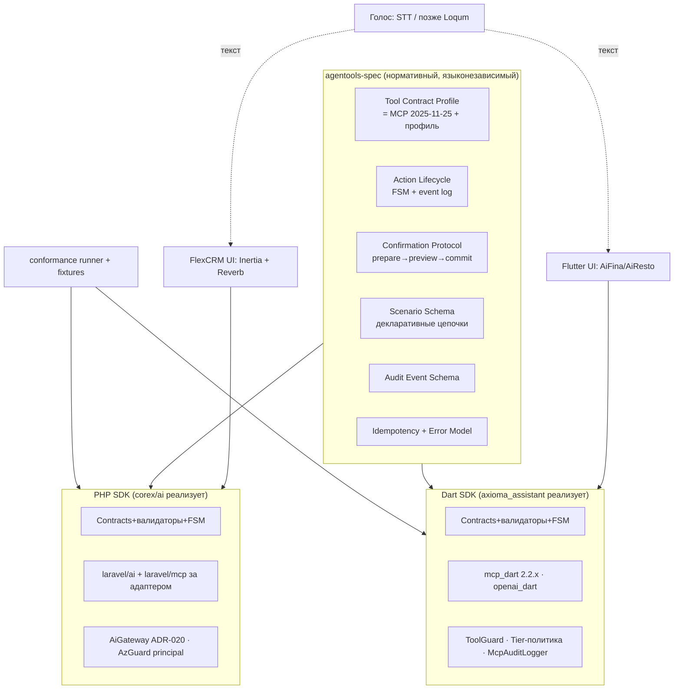

# MASTER PLAN — AgenTools (бывш. рабочее имя AgentKit)

> **Живой документ.** Любая модель, подхватывающая работу, начинает чтение отсюда.
> Создан: 2026-07-07 (design-фаза, research-фанаут 21 агент + adversarial verify).
> Статус: **решения D1–D14 УТВЕРЖДЕНЫ пользователем 2026-07-07.** Следующий шаг — P0 (детализация).
>
> **Имя пакета: AgenTools** (slug `agentools`; утверждено чекпойнтом, см. D2). В R-файлах и цитатах «AgentKit» = историческое рабочее имя — читать как AgenTools.

---

## 1. Миссия

Спроектировать и построить **универсальный переиспользуемый слой agent + tools + сценарии** для всей продуктовой экосистемы:

- **FlexCRM** (Laravel 13, ядро CoreX): сотрудник на главном экране пишет/наговаривает «сформируй отчёт о проделанной работе…» → агент матчит намерение на зарегистрированные доменные tools, вычищает лишнее, показывает preview + кнопку «Отправить отчёт», после подтверждения пишет в БД.
- **AiFina / AiResto** (Dart: Serverpod cloud / Shelf local, ядро AxiomaErpSdk): главбух спрашивает «кто ходил в отпуск в этом месяце», «сформируй отчёт по параметрам»; локальная установка опционально ходит в облачный MCP.
- Далее — FlexStore/FlexCMS, другие продукты.

Ключевые способности: intent → выбор tool/цепочки, **интерактивные уточнения** (как AskUserQuestion в Claude Code: варианты ответа, «правильно ли я понял?»), **preview + confirmation** перед write-действиями, multi-tool сценарии, идемпотентность, полный аудит.

Вход: `90_inbox/` → `primary_analysis_agent_tool_unified.md` (первичный анализ Perplexity).

## 2. Resume-протокол

1. Прочитай этот файл целиком (особенно §4 решения и §9 фазы).
2. Ключевые входы: `20_research/R-00_internal-recon.md` (ОБЯЗАТЕЛЬНО — контекст экосистемы), затем профильный R-0X по своей задаче.
3. Решения D1–D12 не пересматривать без пользователя.
4. Внешние факты — только через RAG с источником; без источника — `[UNVERIFIED]`.
5. Кода в этой папке не пишем — реализация пойдёт по фазам §9 командами `/task:dev`.

## 3. Главный вывод research (сжато)

Исследованы 3 внутренних грани (R-00) и 6 внешних (R-01…R-06), критичные факты проверены adversarial-агентами (R-07). **Все шесть внешних граней независимо сошлись на одном ответе** на центральный вопрос «Python-мост vs per-language vs гибрид»:

| Вариант | Вердикт | Ключевые причины |
|:---|:---|:---|
| A. Python-ядро/LiveKit как единый мост | ❌ отклонить | LiveKit Agents = Python/Node-only realtime-**voice** фреймворк; текстовая форма превращается в WebRTC-room+worker ради одного tool-loop; offline-first AiResto (локальный Shelf без облака) физически несовместим с облачным Python-ядром → Dart-реализация нужна В ЛЮБОМ СЛУЧАЕ, «единое ядро» иллюзорно; третий runtime в проде нарушает ADR-001 Axioma «Dart everywhere» и ADR-020 CoreX (внешний LLM-прокси отвергнут); ops self-hosted LiveKit = собственная RTC-платформа (R-05) |
| B. Две независимые реализации без спеки | ❌ отклонить | гарантированное расхождение поведения; уже сейчас Flex (stake low/med/high) и Axioma (Tier 0/1/2) называют одно и то же по-разному (R-00) |
| C. **Protocol-first гибрид: спека + 2 нативных SDK** | ✅ **принять** | эталонный индустриальный паттерн (MCP, OpenTelemetry, protobuf conformance — R-06); MCP закрывает wire-слой tools + уточнения (elicitation); agent-loop на современных SDK = сотни строк на язык, дублирование дешевле моста; поддержка двух тонких SDK силами AI-агентов — норм (это и было допущение пользователя); консистентность держат shared test fixtures + conformance-gate в CI |

**Второй главный вывод (неожиданный, из R-00):** оба контура экосистемы УЖЕ имеют детально спроектированные agent-слои — `corex/ai` (AgentRuntime, ToolRegistry, AiGateway ADR-020, stake-семантика, агент = principal AzGuard; спека B-13/R-06 flex) и `axioma_mcp`+`axioma_assistant` (AxiomaTool с tier, ToolGuard, McpAuditLogger, pipeline ASR→LLM→IntentRouter→MCP; ADR-004/010/012). **AgentKit не должен становиться третьим конкурирующим рантаймом.** Его роль — то, чего нет ни у одного из них: общая спека семантики + conformance + недостающие протокольные куски (сценарии-цепочки, two-phase confirmation, единая модель side-effect, audit-schema, idempotency).

## 4. Зафиксированные решения (УТВЕРЖДЕНЫ 2026-07-07 — не пересматривать без пользователя)

| # | Решение | Основание |
|---|---|---|
| D1 | **Архитектура: protocol-first гибрид (вариант C).** Языконезависимая спека (markdown + JSON Schema, датированные ревизии) + 2 нативных SDK: PHP и Dart. Python-мост и Rust/FFI-ядро отклонены | R-04, R-05, R-06; ограничения ADR-001 Axioma, ADR-020 CoreX |
| D2 | **Имя пакета: AgenTools** (утверждено пользователем 2026-07-07; slug `agentools`). Предпосылка: «AgentKit» занято ТРЕМЯ игроками (OpenAI, Coinbase, World — verify R-07 #16). Проверка коллизий AgenTools (WebSearch 2026-07-07): заметных пакетов/продуктов под точным именем `agentools` не найдено; вариант «AigenTools» отклонён — [aigentools.io](https://aigentools.io/) уже живой продукт с тем же slug, плюс кластер aigent.software / aigen.tools / aigent (GitHub CLI). Остаточный минус: фраза «agent tools» генерична для поиска → в доках всегда писать слитно AgenTools | чекпойнт пользователя, R-07 |
| D3 | **Wire-протокол tools = MCP, таргет — ревизия 2025-11-25.** Tool contract (inputSchema/outputSchema JSON Schema 2020-12, structuredContent), аннотации side effects, streamable HTTP + OAuth 2.1 (кейс «AiFina local → облачный MCP»). Проектировать stateless-ready под ревизию 2026-07-28: НЕ строить на Roots/Sampling/Logging/DCR (deprecated), состояние сессии — в БД приложения, не в MCP-сессии | R-03, R-07 |
| D4 | **Уточняющие вопросы = MCP elicitation** (form-mode: enum single/multi-select с titles, defaults, «правильно ли я понял?» = boolean confirm; url-mode для OAuth/платежей). Клиент — наши же UI (Flutter/Inertia), зависимость от зрелости чужих клиентов нулевая | R-03, R-04 |
| D5 | **LLM-вызовы — напрямую через нативные шлюзы рантаймов** (PHP: AiGateway ADR-020; Dart: LLMProvider ADR-012), НЕ через MCP sampling (deprecated в 2026-07-28). ControLLM — опциональный OpenAI-совместимый base_url, не жёсткая зависимость | R-03, R-00 |
| D6 | **Добавленная стоимость пакета = собственная спека ПОВЕРХ MCP** (5 нормативных документов): ① Action Lifecycle (FSM сессии + append-only event log), ② Confirmation Protocol (two-phase prepare→preview→commit + confirmation token + unified side-effect model), ③ Scenario Schema (декларативные цепочки tools как данные), ④ Audit Event Schema, ⑤ Idempotency & Error Model | R-03 (гэпы MCP), R-04 (durable-консенсус) |
| D7 | **Единая модель side-effect, примиряющая Flex и Axioma:** `side_effect: read \| draft \| write \| irreversible` × `confirmation: none \| confirm \| double_confirm`. Маппинг: read=Tier0=stake low; draft=Tier1; write=Tier2=stake med/high (confirm); irreversible=double_confirm. Спека фиксирует таблицу соответствия, рантаймы сохраняют свои термины как алиасы | R-00 |
| D8 | **AgentKit НЕ заменяет corex/ai и axioma_assistant — они его реализуют.** PHP SDK = библиотека контрактов+валидаторов+FSM, которую corex/ai подключает (per package-contribution-protocol); Dart SDK = реализация/расширение контрактов axioma_assistant/axioma_mcp. Ни второго ToolRegistry, ни обхода AiGateway/ToolGuard | R-00 (жёсткие constraints обоих контуров) |
| D9 | **Монорепо**: `spec/` + `fixtures/` (языконезависимые тест-векторы + golden files) + `conformance/` (runner через CLI-адаптер каждого SDK) + `php/` + `dart/`. CI-гейт: изменение spec/fixtures не мёржится, пока оба SDK не зелёные. Допустима асимметрия зрелости SDK (паттерн MCP SDK-тиров) | R-06 |
| D10 | **Durable-механика без внешнего оркестратора**: чекпоинт на каждом шаге сценария, event log в БД приложения (тенантской — D1 Flex), resume-token = указатель на чекпоинт; idempotency key = `tenant:session:step:hash(canonical_args)` c dedupe-таблицей на границе tool. Temporal/Restate в ядро не тащить (нет Dart SDK, лишний инфра-компонент); PHP-опция `durable-workflow/workflow` (бывш. laravel-workflow; жив: v1.0.77 01.07.2026, L12/13, Waterline UI) — как внутренняя деталь corex, не требование спеки | R-04, R-07 |
| D11 | **Сценарии = декларативные данные** (JSON/YAML по версионируемой JSON Schema), интерпретируемые обоими рантаймами. v1: линейные цепочки + условия + approval-гейты; циклы запрещены; saga-компенсации — только для транзакционных write-цепочек | R-04, R-06 |
| D12 | **Голос = отдельный edge-канал, не часть ядра.** Voice → STT → тот же текстовый протокол. Интеграция с Loqum (LiveKit) — позднейшая опция для realtime-диалога; протокольные паттерны Loqum SPEC-05 (команды-как-данные, ack/revoke/TTL, policy до dispatch) переиспользуются в Confirmation Protocol. Подтверждено пользователем на чекпойнте: LiveKit нужен только для потокового live-диалога, подключается позже мостом | R-05, R-00, чекпойнт |
| D13 | **Всё приватно.** Спека + SDK в приватном репо `~/projects/packages/agentools/`; дистрибуция через собственный composer-репозиторий / RegHub (как corex). Открыть позже можно всегда, обратно — нельзя | чекпойнт пользователя |
| D14 | **PHP-first**: порядок фаз P2 (PHP SDK) → P3 (Dart SDK). FlexCRM execution уже идёт, corex/ai детально спроектирован — вертикальный срез быстрее; Axioma Фаза 0 ещё не стартовала | чекпойнт пользователя |

## 5. Архитектура

### 5.1 Слои



### 5.2 FSM сессии (Action Lifecycle, консенсус R-04)

Состояния: `CREATED → RUNNING → WAITING_INPUT (elicitation) | WAITING_APPROVAL (preview) | EXECUTING_TOOL → COMPLETED | FAILED_RETRYABLE | FAILED_TERMINAL | CANCELLED | EXPIRED`.

- Поверх **append-only event log** — он же аудит; состояние = свёртка событий.
- Чекпоинт на каждом переходе; сессия может висеть в WAITING_* днями и резюмироваться на другой машине/после рестарта.
- Урок LangGraph: при resume шаг перезапускается с начала → все side effects до гейта обязаны быть идемпотентными.
- LLM — «decision function» внутри шага, не владелец control flow.

### 5.3 Confirmation Protocol (two-phase)

1. `prepare(args)` → tool возвращает **preview payload** (structuredContent: diff/сводка «что будет записано») + сервер персистит pending action c `confirmation_token` и TTL.
2. UI показывает preview → пользователь `accept | decline | edit`.
3. `commit(confirmation_token)` c idempotency key → исполнение; ответ-событие в event log с governance-метаданными (кто, когда, scope, expiry).
4. Политика гейта — из unified side-effect model (D7): read → без гейта; write → confirm; irreversible → double_confirm. Для внутренних (trusted) серверов MCP-аннотации становятся enforcement-сигналом.
5. Паттерны из Loqum SPEC-05: policy-валидация ДО показа пользователю (anti prompt-injection), ack как аудит «план/факт», revoke/TTL.

### 5.4 Scenario Schema (v1)

```yaml
scenario: crm.daily_report@1
steps:
  - id: extract        # LLM-шаг: голос/текст → структурированный черновик
    kind: llm
    output_schema: DailyReportDraft
  - id: clarify        # опционален: добор недостающих полей
    kind: elicitation
    when: "missing(required_fields)"
  - id: save
    kind: tool
    tool: crm_report_create      # side_effect: write → авто-гейт preview+confirm
    input_map: { body: $extract.text, date: $ctx.today }
    on_semantic_fail: abort      # отдельные ветки semantic vs technical (R-06 flex §2.7)
    on_technical_fail: retry(2)
```

Циклов нет; условия — ограниченный expression-язык (только чтение переменных, консенсус R-12 flex: SEL hardened); компенсации `compensate: {tool, input_map}` — только для write-цепочек.

### 5.5 Кто что реализует (разграничение — D8)

| Понятие спеки | PHP: corex/ai (Flex) | Dart: axioma_* (AiFina/AiResto) |
|:---|:---|:---|
| Tool contract | ToolProvider/ToolRegistry (один реестр на MCP+runtime) | AxiomaTool + axioma_mcp (in-process, mcp_dart 2.2) |
| Side-effect/гейт | stake low/med/high ← алиасы D7 | Tier 0/1/2 ← алиасы D7 |
| Уточнения | command envelope (confidence<0.6 → вопрос) + Reverb в UI | elicitation mcp_dart/dart_mcp + Flutter UI |
| LLM | AiGateway (маска ПДн→бюджет→драйвер→ledger) | LLMProvider (GigaChat/YandexGPT, ADR-012) |
| Права | AzGuard: agent-principal, intersection(user, agent-role) | ToolGuard + requiredPermission + манифест module.json |
| Durable session | ai_threads/ai_turns/ai_tool_calls (тенантская БД) | Drift/Serverpod-персист + FSM (кандидат statecraft) |
| Аудит | ai_tool_calls + Audit Log corex/core | McpAuditLogger + AuditTrail finance |
| Голос | STT-драйвер AiGateway; позже Loqum | Yandex SpeechKit gRPC (ADR-012); позже Loqum |

Спека обязана быть **вычитаемым подмножеством** уже принятых контрактов обоих контуров — расхождение спеки с ADR corex/axioma = дефект спеки, эскалировать пользователю, не менять ADR молча.

### 5.6 Гэп текущих контрактов, который спека обязана закрыть

- Axioma `LlmResponse = {text?, toolCall?}` — ОДИНОЧНЫЙ tool call; multi-tool цепочки не заложены → Scenario Runner в Dart SDK становится расширением AssistantOrchestrator (новая точка pipeline, не слом контракта).
- Ни один из контуров не имеет формата сценариев-как-данных и conformance-фикстур — это целиком новое.
- Elicitation в PHP (verify R-07 #5, #18): laravel/mcp v0.8.2 — подтверждённо отсутствует (PR #190 закрыт без мержа); официальный mcp/sdk v0.6.0 — **server-side elicitation ЕСТЬ** (ClientGateway::elicit, SEP-1330 enum-варианты, протокол 2025-11-25), нет только client-side обработчика (PR #371 open). Т.е. доменный MCP-сервер на PHP МОЖЕТ запрашивать уточнения протокольно; наш хост-клиент (он же UI) реализует обработчик сам (Reverb-события по образцу command envelope B-13). Спека описывает семантику уточнения, транспорт — деталь рантайма.

## 6. Стек-пины (проверено RAG 2026-07-07, вердикты в R-07)

| Компонент | Версия/статус | Роль |
|:---|:---|:---|
| MCP спека | **2025-11-25** (Current); 2026-07-28 финал ~через 3 нед — stateless, депрекация Roots/Sampling/Logging/DCR | wire-протокол tools |
| laravel/ai | v0.8.1 (10.06.2026), first-party, **пре-1.0**, HITL НЕТ (PR #209 закрыт) | база PHP LLM/agent-слоя за адаптером |
| laravel/mcp | v0.8.2 (26.06.2026), server+**client** (STDIO+HTTP, OAuth), elicitation НЕТ | MCP PHP |
| mcp/sdk (official PHP) | v0.6.0 (02.06.2026), Symfony+PHP Foundation, server+client, **server-side elicitation ЕСТЬ** (SEP-1330), default protocol 2025-11-25; client-side elicitation — PR #371 open | серьёзный кандидат для MCP-серверной части PHP |
| Neuron AI | v3.15.22 (03.07.2026), единственный PHP с durable HITL (interrupt/ApprovalRequest/checkpoint) | референс паттернов, fallback |
| mcp_dart | v2.2.2, спека 2025-11-25, elicitation+tasks, уже запиннен в Axioma | MCP Dart |
| dart_mcp (dart-lang/ai) | v0.5.2, официальный, elicitation form+url | альтернатива/референс |
| Genkit Dart | 0.14.1, **Preview** (breaking в минорах), interrupts = готовый HITL | референс, НЕ база (см. §10) |
| openai_dart | актуальная 7.x (не 3.0!), custom baseUrl для RU-провайдеров | LLM-клиент Dart |
| LiveKit Agents | 1.6.4, Python/Node-only, text-only режим есть, но комнатная семантика | только голосовой edge (Loqum) |

## 7. Нефункциональные требования (перенос из первичного анализа, уточнены)

Наблюдаемость/трейс (W3C Trace Context через `_meta` — придёт в MCP 2026-07-28), полный audit trail, детерминированный preview, идемпотентность write, строгая типизация контрактов, contract testing (fixtures+conformance — D9), simulation без реального LLM (fake-провайдеры обоих SDK), human-in-the-loop, headless/API-first. Протокол не предполагает большие модели: локальный контур AiResto = малые LLM через Ollama/OpenAI-совместимый API + подробные tool-descriptions (R-00, offline-llm-mcp).

## 8. Риски

| Риск | Митигация |
|:---|:---|
| Спека ради спеки: оверинжиниринг при одном владельце обоих SDK | спека = только 5 документов D6, всё остальное — в рантаймах; ревизии спеки датированные, MVP-фазы режут объём (§9) |
| 0.x-зависимости (laravel/ai, laravel/mcp, mcp/sdk, Genkit) | пиннинг + собственные контракты-фасады (уже принято ADR-020/R-16 flex); breaking не протекает в продукты |
| MCP-разворот 2026-07-28 (stateless) | D3: не строить на deprecated фичах; состояние — в БД приложения; миграционное окно >12 мес |
| Расхождение SDK | conformance-gate CI (D9); golden files на сериализацию |
| Конфликт имени | D2: переименовать до первого публичного артефакта + trademark search |
| Слабый function calling малых/RU-моделей | RetryingStructuredOutput-паттерн (уже в ADR-020), валидация схем на границе, confidence-порог → уточнение вместо действия |
| Контаминация контуров (Flex ↔ Axioma) | спека нейтральна по бренду; примеры в спеке — абстрактные; интеграционные детали живут в доках продуктов |

## 9. Фазы реализации (для `/task:*` после утверждения)

| Фаза | Содержимое | Выход | Команда |
|:---|:---|:---|:---|
| P0 | Детализация спеки: 5 нормативных доков D6 + JSON Schema + маппинг-таблица D7 + 10–15 первых fixtures | ✅ Готово (2026-07-10) — `~/projects/packages/agentools`, `spec/revisions/2026-07-draft/` (7 нормативных доков 00–06 + JSON Schema 2020-12 + fixtures/15 векторов + 4 golden-пары); детали P0.1–P0.10 → `plans/AGENTOOLS/phases/P0.md` | `/task:plan-design` → `/task:dev` |
| P1 | Conformance runner (CLI-адаптер, JSON pass/fail по образцу modelcontextprotocol/conformance) | `conformance/` | `/task:dev` |
| P2 | PHP SDK v0.1: контракты, FSM, Confirmation, Scenario Runner; интеграция в corex/ai через package-contribution-протокол | `php/` зелёный на fixtures | `/task:dev` |
| P3 | Dart SDK v0.1: контракты, FSM, Scenario Runner как расширение AssistantOrchestrator | `dart/` зелёный на fixtures | `/task:dev` |
| P4 | MVP-интеграция FlexCRM: сценарий «отчёт о проделанной работе» (voice/text → draft → preview → confirm → запись) + 5–8 read / 3–5 draft / 2–3 write tools | рабочий вертикальный срез | `/task:dev` |
| P5 | Перенос на AiFina (сценарии главбуха), затем гэп-анализ AiResto offline | отчёт применимости | `/task:dev` |

Порядок зафиксирован D14: **PHP-first** (P2 → P3).

## 10. Обсуждение (спорное — с рецензией и рекомендацией)

### 10.1 Имя пакета — ✅ РЕШЕНО: AgenTools (чекпойнт 2026-07-07, см. D2)

Исторический контекст выбора. «AgentKit» занято минимум трижды (OpenAI — прямая ниша; Coinbase — web3-агенты, GA; World/Worldcoin — human-verification для агентов). Рассматривался шорт-лист:

| Кандидат | За | Против |
|:---|:---|:---|
| **ToolPact** (рекоменд.) | pact = контракт → точно отражает суть (спека-договор между рантаймами); низкая коллизия; согласуется со стилем экосистемы (AzGuard, ControLLM) | англ. слово составное, менее «брендовое» |
| Actum | коротко, лат. «действие/акт» | генерик, есть мелкие SaaS-коллизии |
| AgentPact | понятнее ToolPact | слово agent в имени — та же зона коллизий |
| Intentum | intent-центрично | длинновато, латынь не всем читается |

Пользователь выбрал собственный вариант **AgenTools** (портманто agent+tools с общей «t»). Уточняющий вопрос «AigentTools лучше?» разобран фактами: НЕТ — aigentools.io уже живой продукт (AI-генерация) с точно таким slug, кластер «aigent*» плотно занят; у `agentools` заметных коллизий не найдено (WebSearch 2026-07-07). Юридический trademark-поиск по-прежнему не выполнялся — провести перед первым внешним артефактом.

### 10.2 Genkit Dart как база Dart-рантайма?

Research (R-02) предлагал «адаптер над Genkit» — interrupts дают готовый HITL. **Рецензия против:** Genkit — Preview с политикой «breaking в минорах»; тянет свою модель flows, конкурирующую с уже принятыми контрактами axioma_assistant; ADR-012 требует RU-провайдеров (Genkit-плагины — Google-first, openai-совместимость есть, но это ещё один слой); Loqum уже обжёгся на framework churn LiveKit (7 релизов/мес) и строит anti-corruption швы. **Рекомендация: собственный тонкий loop** (сотни строк) поверх mcp_dart + openai_dart, реализующий контракты axioma_assistant; Genkit interrupts — референс дизайна pause/resume. Пересмотреть после Genkit 1.0.

### 10.3 Где живёт спека — отдельный репо или внутри CoreX/Axioma?

Варианты: (а) отдельный монорепо `~/projects/packages/<имя>/` (spec+fixtures+conformance+php+dart); (б) spec внутри CoreX, Dart-порт в Axioma. **Рецензия:** (б) создаёт направление зависимости «Axioma смотрит в репо Flex» — контаминация контуров и нарушение приватности ядра Axioma; (а) соответствует прецеденту экосистемы (AzGuard, Botkit — самостоятельные пакеты) и паттерну R-06 (MCP-монорепо). Нюанс лицензий: спека и conformance могут быть MIT (как CoreX), но php/ содержит интеграцию в приватную дистрибуцию corex, dart/ — в приватный Axioma SDK → в монорепо держать только НЕЙТРАЛЬНЫЕ SDK-ядра, продуктовые адаптеры — в репо продуктов. **Рекомендация: (а)**.

### 10.4 Не дублирует ли пакет то, что уже спроектировано?

Честный ответ: corex/ai и axioma_assistant покрывают ~70% функциональных требований первичного анализа В СВОИХ контурах. Добавленная стоимость пакета — оставшиеся 30%, но они общесистемные: единая семантика side-effect/confirmation (сейчас stake vs tier — разные), сценарии-как-данные (нет нигде), two-phase confirmation как протокол (сейчас UI-паттерн, не контракт), conformance (нет нигде), multi-tool цепочки в Dart (контракт не заложен). Если пользователь решит НЕ делать отдельный пакет — минимальная альтернатива: оформить те же 5 документов D6 как «межконтурную конвенцию» в vault (02-Knowledge/) и реализовать в каждом контуре независимо. Рекомендация — пакет всё же делать: conformance-фикстуры исполняемы только при общем репо, а именно они держат AI-поддерживаемые порты честными.

## 11. Открытые вопросы

1. ~~Финальное имя~~ ✅ AgenTools (D2, чекпойнт 2026-07-07).
2. ~~Утверждение D1–D12~~ ✅ утверждены + D13 (приватно), D14 (PHP-first).
3. ~~Лицензия~~ ✅ всё приватно (D13).
4. MCP Tasks (длинные операции) — в спеку v1 или отложить? Кандидат: отложить, polling закрыт FSM-состояниями.
5. ~~Порядок P2/P3~~ ✅ PHP-first (D14).
6. Юр. sign-off 152-ФЗ на облачные LLM (унаследован из ADR-020 flex, открыт там же).
7. Голосовое подтверждение («да, создавай») в Confirmation Protocol v1 или v1.1.
8. Trademark-поиск «AgenTools» перед первым внешним артефактом (доменом/публикацией).

## 12. Структура папки и провенанс

Спека v0.1-draft (P0, готова 2026-07-10) живёт в коде, не в vault:
```
~/projects/packages/agentools/          ← приватный git-репо (без remote)
  spec/revisions/2026-07-draft/
    00_overview.md .. 06_idempotency-errors.md   7 нормативных доков
    schema/                                       JSON Schema 2020-12 к каждому
  fixtures/                                        15 тест-векторов + 4 golden-пары
  tools/spec_lint.py                               стдlib-only линтер спеки
```

```
plans/AGENTOOLS/
  plan.md + phases/P0..P5 + handoff.md   ← EXECUTABLE-ПЛАН (plan-протокол; исполнение — с него)
  00_MASTER_PLAN.md            ← ты здесь (дизайн и решения D1–D14)
  10_decisions/                (журнал интеграционных решений: INT-001 и далее)
  20_research/
    R-00_internal-recon.md     внутренняя разведка: corex/ai, axioma_*, Loqum, ControLLM
    R-01_php-laravel.md        PHP-экосистема (laravel/ai, Prism, Neuron, mcp/sdk)
    R-02_dart-flutter.md       Dart-экосистема (mcp_dart, dart_mcp, Genkit, openai_dart)
    R-03_mcp-protocol.md       MCP: ревизии, elicitation, гэпы
    R-04_orchestration-hitl.md durable+HITL паттерны (LangGraph, Vercel, Neuron, laravel-workflow)
    R-05_livekit-bridge.md     LiveKit/Python-мост: оценка и отказ
    R-06_cross-language.md     прецеденты «спека + N SDK», conformance-практики
    R-07_verification.md       вердикты adversarial-проверок (2 волны)
  90_inbox/
    primary_analysis_agent_tool_unified.md   первичный анализ Perplexity (вход)
```

Все внешние источники — в секциях Sources соответствующих R-файлов.
