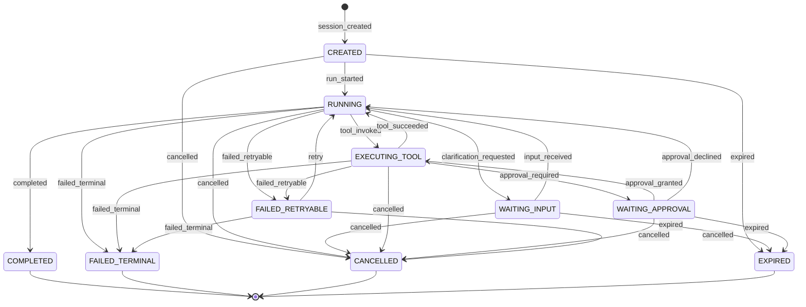

# 02 — Action Lifecycle

> Ревизия спеки: `2026-07-draft` (см. `README.md`). Статус: draft.
> Нормативные ключевые слова — по [RFC 2119](https://www.rfc-editor.org/rfc/rfc2119)
> (MUST / SHOULD / MAY). Термины профиля инструмента — `01_tool-contract-profile.md`.

Документ задаёт **жизненный цикл действия** (сессии) AgenTools: конечный автомат (FSM)
состояний, append-only событийный лог, чекпоинты и возобновление (resume). Это общий
скелет обоих рантаймов: одна и та же FSM держит и оркестрацию шагов, и аудит, и
durable-механику «сессия висит в ожидании днями и продолжается после рестарта» (D10
мастер-плана, консенсус durable-паттернов R-04).

Ключевой принцип (LangGraph, R-04): **состояние сессии не хранится как истина само по
себе — оно есть детерминированная свёртка (fold) событийного лога.** Лог append-only,
поэтому он же и есть аудит, и он же позволяет воспроизвести состояние на другой машине.

LLM в этой модели — **decision function** внутри шага, а не владелец потока управления
(LC-20). Переходы выполняет рантайм строго по таблице, а не по «фантазии» модели.

Схемы к документу: `schema/lifecycle-event.json`, `schema/session-state.json`.

---

## 1. Состояния FSM

**LC-1 (MUST).** Сессия находится ровно в одном из десяти состояний; иных состояний
нет:

| Состояние          | Класс         | Смысл |
|:-------------------|:--------------|:------|
| `CREATED`          | нетерминальное| сессия заведена, исполнение ещё не начато |
| `RUNNING`          | нетерминальное| активный шаг: LLM принимает решение (уточнить / вызвать инструмент / завершить) |
| `WAITING_INPUT`    | нетерминальное| ожидание уточнения от пользователя (elicitation, `03_confirmation-protocol.md`) |
| `WAITING_APPROVAL` | нетерминальное| превью write-действия показано, ожидается подтверждение |
| `EXECUTING_TOOL`   | нетерминальное| исполняется вызов инструмента (read/draft, либо фаза prepare/commit write-инструмента) |
| `COMPLETED`        | **терминальное**| сессия успешно завершена |
| `FAILED_RETRYABLE` | нетерминальное| обратимый сбой: допустим повтор в пределах бюджета |
| `FAILED_TERMINAL`  | **терминальное**| неустранимый отказ |
| `CANCELLED`        | **терминальное**| отменена субъектом (в т.ч. revoke до commit) |
| `EXPIRED`          | **терминальное**| истёк TTL ожидания |

**LC-2 (MUST).** Терминальные состояния — `COMPLETED`, `FAILED_TERMINAL`, `CANCELLED`,
`EXPIRED` — **не имеют исходящих переходов**. Сессия в терминальном состоянии
неизменяема: любое последующее событие для неё MUST быть отвергнуто.

## 2. Таблица переходов

**LC-3 (MUST).** Таблица ниже (`LC-T1`…`LC-T24`) — **единственный** источник допустимых
переходов. Любой переход, отсутствующий в таблице, MUST быть отвергнут (свёртка лога с
недопустимым переходом — ошибка целостности, а не «новое состояние»). Колонка «Kind» —
тип события конверта (`lifecycle-event.json`), несущего переход; для строк `state_changed`
триггер — значение `payload.trigger`.

| #       | Из (from)          | Событие (trigger)         | Kind                | В (to)             |
|:--------|:-------------------|:--------------------------|:--------------------|:-------------------|
| LC-T1   | `CREATED`          | `run_started`             | `state_changed`     | `RUNNING`          |
| LC-T2   | `CREATED`          | `cancelled`               | `session_cancelled` | `CANCELLED`        |
| LC-T3   | `CREATED`          | `expired`                 | `session_expired`   | `EXPIRED`          |
| LC-T4   | `RUNNING`          | `clarification_requested` | `state_changed`     | `WAITING_INPUT`    |
| LC-T5   | `RUNNING`          | `tool_invoked`            | `state_changed`     | `EXECUTING_TOOL`   |
| LC-T6   | `RUNNING`          | `completed`               | `session_completed` | `COMPLETED`        |
| LC-T7   | `RUNNING`          | `failed_retryable`        | `state_changed`     | `FAILED_RETRYABLE` |
| LC-T8   | `RUNNING`          | `failed_terminal`         | `session_failed`    | `FAILED_TERMINAL`  |
| LC-T9   | `RUNNING`          | `cancelled`               | `session_cancelled` | `CANCELLED`        |
| LC-T10  | `WAITING_INPUT`    | `input_received`          | `state_changed`     | `RUNNING`          |
| LC-T11  | `WAITING_INPUT`    | `cancelled`               | `session_cancelled` | `CANCELLED`        |
| LC-T12  | `WAITING_INPUT`    | `expired`                 | `session_expired`   | `EXPIRED`          |
| LC-T13  | `EXECUTING_TOOL`   | `approval_required`       | `state_changed`     | `WAITING_APPROVAL` |
| LC-T14  | `EXECUTING_TOOL`   | `tool_succeeded`          | `state_changed`     | `RUNNING`          |
| LC-T15  | `EXECUTING_TOOL`   | `failed_retryable`        | `state_changed`     | `FAILED_RETRYABLE` |
| LC-T16  | `EXECUTING_TOOL`   | `failed_terminal`         | `session_failed`    | `FAILED_TERMINAL`  |
| LC-T17  | `EXECUTING_TOOL`   | `cancelled`               | `session_cancelled` | `CANCELLED`        |
| LC-T18  | `WAITING_APPROVAL` | `approval_granted`        | `state_changed`     | `EXECUTING_TOOL`   |
| LC-T19  | `WAITING_APPROVAL` | `approval_declined`       | `state_changed`     | `RUNNING`          |
| LC-T20  | `WAITING_APPROVAL` | `cancelled`               | `session_cancelled` | `CANCELLED`        |
| LC-T21  | `WAITING_APPROVAL` | `expired`                 | `session_expired`   | `EXPIRED`          |
| LC-T22  | `FAILED_RETRYABLE` | `retry`                   | `state_changed`     | `RUNNING`          |
| LC-T23  | `FAILED_RETRYABLE` | `failed_terminal`         | `session_failed`    | `FAILED_TERMINAL`  |
| LC-T24  | `FAILED_RETRYABLE` | `cancelled`               | `session_cancelled` | `CANCELLED`        |

Событие `session_created` не является переходом (у него нет «из»): оно рождает сессию
сразу в состоянии `CREATED` (LC-11). События `checkpoint` и `resumed` — операционные
маркеры, состояние не меняют (LC-14) и в таблице отсутствуют.

**Привязка two-phase (`01`/`03`).** Фаза prepare write-инструмента исполняется в
`EXECUTING_TOOL` и, вернув превью и токен, ведёт в `WAITING_APPROVAL` (LC-T13). Согласие
пользователя запускает фазу commit — снова `EXECUTING_TOOL` (LC-T18), успех commit
возвращает в `RUNNING` (LC-T14). Уточняющий вопрос ведёт из `RUNNING` в `WAITING_INPUT`
(LC-T4). Эти привязки к состояниям — нормативная опора для правил `03_confirmation-protocol.md`.

### Диаграмма (информативная)

Нормативна таблица переходов; диаграмма приведена для наглядности.



## 3. Событийная модель

Все изменения сессии выражаются событиями в append-only логе. Схема конверта —
`schema/lifecycle-event.json`.

**LC-4 (MUST).** Состояние сессии есть детерминированная **свёртка** (fold) её лога:
одинаковый лог у PHP- и Dart-рантаймов MUST давать одинаковое состояние. Рантайм MUST
NOT выводить состояние из чего-либо, кроме лога (§4 — resume).

**LC-5 (MUST).** Конверт события содержит поля: `event_id`, `session_id`, `seq`, `ts`,
`actor {type, id}`, `kind`, `payload`, `spec_rev` (все обязательны).

**LC-6 (MUST).** `seq` монотонен в пределах сессии, стартует с **1**, идёт **без дыр**.
Пропуск или повтор `seq` — нарушение целостности лога.

**LC-7 (MUST).** `event_id` — ULID. Запись события **идемпотентна по `event_id`**:
повторный append с тем же `event_id` MUST NOT создать дубль (безопасность at-least-once
доставки при рестартах).

**LC-8 (MUST).** Лог **append-only**: записанные события не обновляются и не удаляются.
Исправление — только новым событием.

**LC-9 (MUST).** `ts` — RFC3339 в UTC.

**LC-10 (MUST).** `kind` принадлежит закрытому enum из восьми значений
(`session_created`, `state_changed`, `checkpoint`, `session_completed`, `session_failed`,
`session_cancelled`, `session_expired`, `resumed`); форма `payload` выбирается по `kind`
(`oneOf` в схеме). Полная аудит-таксономия (`05_audit-events.md`, фаза P0.7) расширяет
модель **отдельной** схемой `audit-event.json`, которая ссылается на этот конверт, но не
копирует его.

**LC-11 (MUST).** `session_created` — первое событие лога (`seq = 1`) и встречается
ровно один раз; оно рождает сессию в состоянии `CREATED`.

**LC-12 (MUST).** `state_changed.payload` несёт `{from, to, trigger}`. `from` MUST
совпадать с текущим свёрнутым состоянием; пара `(from, trigger)` MUST разрешаться в `to`
по таблице §2, иначе событие отвергается (LC-3).

**LC-13 (MUST).** Переходы в терминальные состояния несут выделенные `kind`
(`session_completed` → `COMPLETED`; `session_failed` → `FAILED_TERMINAL`;
`session_cancelled` → `CANCELLED`; `session_expired` → `EXPIRED`), строго по строкам
таблицы. Обратимый (нетерминальный) сбой идёт через `state_changed`
(`trigger = failed_retryable`, LC-T7/LC-T15) — не через `session_failed`.

**LC-14 (MUST).** `checkpoint` и `resumed` — операционные маркеры: они **не меняют**
свёрнутое состояние. Свёртка MUST их пропускать при вычислении состояния (они значимы
только для восстановления и аудита, §4).

### Функция свёртки (псевдокод, информативно)

`TABLE` = отображение `(from, trigger) → to`, построенное из строк LC-T1…LC-T24 §2 —
единственный источник допустимых переходов. Для терминальных `kind` триггер берётся из
`TRIGGER_OF`, для `state_changed` — из `payload.trigger`.

```python
TRIGGER_OF = {                      # kind → trigger для терминальных исходов
    "session_completed": "completed",
    "session_failed":    "failed_terminal",
    "session_cancelled": "cancelled",
    "session_expired":   "expired",
}

def apply(state, ev):               # применить одно событие к состоянию
    k = ev.kind
    if k == "session_created":
        if state is not None:       # session_created — только первое событие (LC-11)
            raise Reject
        return "CREATED"
    if k in ("checkpoint", "resumed"):
        return state                # маркеры не меняют состояние (LC-14)
    trigger = ev.payload.trigger if k == "state_changed" else TRIGGER_OF[k]
    to = TABLE.get((state, trigger))
    if to is None:                  # переход вне таблицы отвергается (LC-3)
        raise Reject
    if k == "state_changed" and ev.payload.to != to:
        raise Reject                # объявленное to обязано совпасть с таблицей (LC-12)
    return to

def fold(events):                   # состояние = свёртка лога (LC-4)
    state = None                    # None до session_created
    for ev in events:               # порядок = возрастание seq, без дыр (LC-6)
        state = apply(state, ev)
    return state
```

## 4. Чекпоинты и возобновление

**LC-15 (MUST).** Чекпоинт = пара `(session_id, seq)`. Рантайм SHOULD записывать событие
`checkpoint` при входе в **durable-состояние ожидания** (`WAITING_INPUT`,
`WAITING_APPROVAL`) — это точки, из которых сессия может «висеть» и продолжиться после
рестарта.

**LC-16 (MUST).** `resume_token` — **непрозрачная** строка, кодирующая чекпоинт
`(session_id, seq)`. Возобновление = проигрывание (replay) событий сессии до `seq`
свёрткой (§3) для восстановления состояния, затем продолжение исполнения. Потребитель
MUST NOT восстанавливать состояние иным способом, кроме свёртки лога. Факт рехидрации
фиксируется событием `resumed` (`payload.checkpoint_seq`).

**LC-17 (MUST).** При возобновлении **прерванный шаг перезапускается с начала** (урок
LangGraph, R-04): всё, что шаг успел исполнить до гейта (`WAITING_INPUT` /
`WAITING_APPROVAL`), выполнится повторно. Поэтому все побочные эффекты **до** гейта MUST
быть идемпотентными; enforce идемпотентности commit-фазы — по ключу идемпотентности
(`06_idempotency-errors.md`). Это же требование связывает prepare-фазу two-phase (`01`):
prepare обязана быть безопасной к повтору.

## 5. Тайм-ауты

**LC-18 (MUST).** Состояния ожидания несут дедлайн `expires_at`: он присутствует для
`CREATED`, `WAITING_INPUT`, `WAITING_APPROVAL`. По наступлении `expires_at` рантайм MUST
перевести сессию в `EXPIRED` событием `session_expired` (actor `type = system`) —
переходы LC-T3 / LC-T12 / LC-T21. TTL конкретных гейтов подтверждения нормируется в
`03_confirmation-protocol.md` (напр. TTL `confirmation_token`); здесь фиксируется лишь
механика истечения на уровне FSM.

## 6. Контракты хранения

Персистентность — дело потребителя (тенантские `ai_*`-таблицы Flex, Drift/Serverpod
Axioma; D13 плана). SDK описывает лишь **интерфейсы**; конкретное хранилище (SQL,
key-value, in-memory для тестов/conformance) не нормируется.

**LC-19 (MUST).** Определены два контракта:

- **`EventLog`** — источник истины (append-only):
  - `append(event)` — добавить событие; идемпотентно по `event_id` (LC-7); при попытке
    записать несуществующий/повторный `seq` — ошибка целостности (LC-6).
  - `readFrom(seq) -> [event]` — вернуть события начиная с `seq` (для replay/свёртки).
- **`SessionStore`** — материализованная проекция снимка (`schema/session-state.json`):
  - `load(session_id) -> SessionState?` — снимок последнего применённого состояния.
  - `save(snapshot)` — обновить проекцию после применения события.

Снимок `SessionStore` — не истина, а кэш свёртки лога для быстрых операций (список
сессий, поиск истёкших по `expires_at`); его `state`/`seq` MUST соответствовать свёртке
`EventLog` до `seq` (LC-4).

### Приложение A — SQL-скетч (информативно, необязательно)

Иллюстрация одной из возможных реализаций; спека **не** требует SQL и не фиксирует эти
имена/типы.

```
event_log(
  session_id  TEXT     NOT NULL,
  seq         INTEGER  NOT NULL,          -- монотонно, без дыр (LC-6)
  event_id    TEXT     NOT NULL UNIQUE,   -- идемпотентность append (LC-7)
  ts          TEXT     NOT NULL,          -- RFC3339 UTC
  actor_type  TEXT     NOT NULL,
  actor_id    TEXT     NOT NULL,
  kind        TEXT     NOT NULL,
  payload     TEXT     NOT NULL,          -- JSON
  spec_rev    TEXT     NOT NULL,
  PRIMARY KEY (session_id, seq)
);

session_state(                            -- проекция-снимок (не истина)
  session_id  TEXT PRIMARY KEY,
  tenant_id   TEXT,
  state       TEXT NOT NULL,
  seq         INTEGER NOT NULL,
  spec_rev    TEXT NOT NULL,
  created_at  TEXT NOT NULL,
  updated_at  TEXT NOT NULL,
  expires_at  TEXT,                        -- только для CREATED/WAITING_* (LC-18)
  resume_token TEXT
);
```

## 7. Роль LLM

**LC-20 (MUST).** LLM — **decision function**, вызываемая рантаймом внутри `RUNNING`
(выбор следующего действия) и в рамках `EXECUTING_TOOL` (структурирование аргументов
инструмента). LLM **не владеет** потоком управления: переходы FSM выполняет рантайм по
таблице §2, а не вывод модели. Невалидный или неожиданный вывод модели ведёт к штатному
переходу (`failed_retryable` → повтор, либо уточнение), но не к переходу вне таблицы.

---

## Примеры

### Пример 1 — событие рождения сессии

```json
// example: lifecycle-event.json
{
  "event_id": "01J9Z3K7QX8F2N4B6C0D1E2F3G",
  "session_id": "sess_crm_report_42",
  "seq": 1,
  "ts": "2026-07-10T09:00:00Z",
  "actor": { "type": "user", "id": "user_128" },
  "kind": "session_created",
  "payload": {},
  "spec_rev": "2026-07-draft"
}
```

Комментарий: первое событие лога (`seq = 1`), рождает сессию в `CREATED` (LC-11);
`payload` пуст — идентичность и ревизию несёт конверт.

### Пример 2 — переход `EXECUTING_TOOL` → `WAITING_APPROVAL`

Фаза prepare write-инструмента вернула превью, сессия уходит в ожидание подтверждения
(LC-T13):

```json
// example: lifecycle-event.json
{
  "event_id": "01J9Z3M0R5H7A9C1E3G5J7K9N2",
  "session_id": "sess_crm_report_42",
  "seq": 5,
  "ts": "2026-07-10T09:00:12Z",
  "actor": { "type": "agent", "id": "flex_report_agent" },
  "kind": "state_changed",
  "payload": {
    "from": "EXECUTING_TOOL",
    "to": "WAITING_APPROVAL",
    "trigger": "approval_required"
  },
  "spec_rev": "2026-07-draft"
}
```

Комментарий: `from` совпадает с текущим состоянием, пара
(`EXECUTING_TOOL`, `approval_required`) разрешается в `WAITING_APPROVAL` по LC-T13 —
переход допустим (LC-12).

### Пример 3 — снимок приостановленной сессии

```json
// example: session-state.json
{
  "session_id": "sess_crm_report_42",
  "tenant_id": "acme",
  "state": "WAITING_APPROVAL",
  "seq": 5,
  "spec_rev": "2026-07-draft",
  "created_at": "2026-07-10T09:00:00Z",
  "updated_at": "2026-07-10T09:00:12Z",
  "expires_at": "2026-07-10T09:15:12Z",
  "resume_token": "at_rt_c2Vzczo1"
}
```

Комментарий: снимок в durable-состоянии `WAITING_APPROVAL`; присутствуют `expires_at`
(дедлайн гейта, LC-18) и `resume_token` (указатель на чекпоинт `seq = 5`, LC-16). После
рестарта состояние восстанавливается свёрткой лога до `seq = 5`, не из снимка (LC-4).
