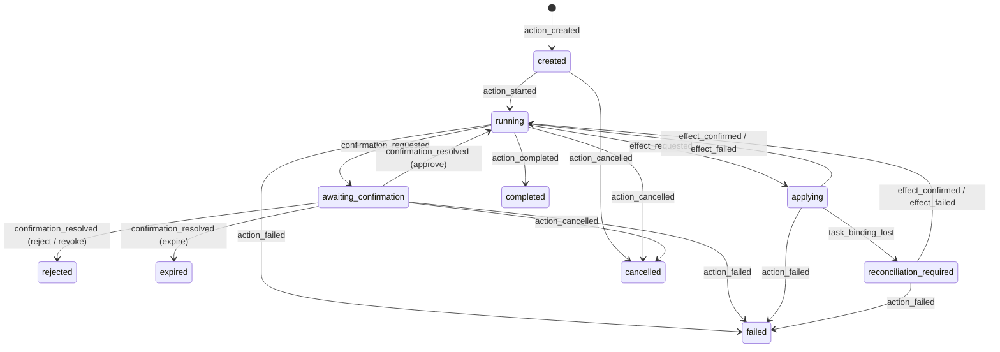

# 03 — Action Lifecycle: журнал как источник истины, эпоха исполнителя, снапшот, хеш-цепочка

> Ревизия спеки: `2026-08` (состав и статус — `README.md`). Базис wire-протокола — MCP
> ревизии `2026-07-28`, зафиксированной пином `spec/vendor/mcp/2026-07-28/PIN.md`.
> Конвенции, глоссарий и уровни соответствия — `00_overview.md`; вендорный префикс и ключ
> данных — `01_extension-identity.md`; форма дескриптора и класс эффекта —
> `02_tool-contract-profile.md`. Нормативные ключевые слова — по
> [RFC 2119](https://www.rfc-editor.org/rfc/rfc2119).

Документ описывает **жизненный цикл действия**: из чего состоит его журнал, как из журнала
получается состояние, какие переходы допустимы, как записывается недетерминированный ввод,
как две одновременно работающие записи не затирают друг друга, чем защищён внешний эффект от
повторного применения зомби-исполнителем и как журнал остаётся проверяемым.

Это общий скелет обоих рантаймов и единственная модель детерминизма, переносимая между
языками. Строгий replay кода (модель Temporal) сравнивает сгенерированные команды **внутри
одного рантайма**: две независимые реализации на разных языках этого физически не дают.
Модель «журналируй шаг и его результат, при повторе пропускай завершённые» переносима и
проверяется общими векторами.
RAG:✅ 2026-07-26 — R-11 §6: две несовместимые модели детерминизма; Restate / DBOS / Inngest /
Cloudflare Workflows дают вторую, переносимую; оптимистичный параллелизм для **доменного**
журнала не даёт готовым ни одна из систем — нормируется здесь.

Уровень документа по умолчанию — `L1` (`00_overview.md` §4). Объявленных отклонений два:
снапшот и хеш-цепочка журнала — `L3`. Схемы к документу — `schema/lifecycle-event.json`,
`schema/session-state.json`, `schema/effect-registry.json`.

---

## 1. Действие, журнал и свёртка

**ALC-1 (MUST, L1).** Действие MUST иметь журнал — append-only последовательность событий,
которая является единственным источником истины о действии. Любое другое хранилище, несущее
состояние действия, есть проекция журнала.

**ALC-2 (MUST NOT, L1).** Реализация MUST NOT восстанавливать состояние действия повторным
исполнением прикладного кода с контролем недетерминизма: восстановление есть чтение журнала и
его свёртка. Строгий replay привязан к одному рантайму и между PHP и Dart не проверяем.

**ALC-3 (MUST, L1).** Состояние действия MUST быть детерминированной свёрткой его журнала:
свёртка есть чистая функция от последовательности событий, и один и тот же журнал даёт одно и
то же состояние в реализации PHP и в реализации Dart. Обращения к часам, случайности,
конфигурации и внешним системам внутри свёртки запрещены.

**ALC-4 (MUST NOT, L1).** Реализация MUST NOT хранить состояние действия как самостоятельную
изменяемую запись, из которой журнал выводится или дополняется: направление зависимости
только одно — журнал первичен, состояние производно.

## 2. Конверт события

**ALC-5 (MUST, L1).** Конверт события MUST нести `event_id`, `action_id`, `seq`,
`expected_prev_seq`, `ts`, `actor`, `kind`, `event_version`, `spec_rev` и `payload`; сверх этого
перечня конверт несёт только `epoch` и `prev_hash`, вводимые правилами `ALC-27` и `ALC-35`.
Перечень полей конверта закрыт: поле, не названное здесь, частью конверта не является и живёт
в `payload`.

**ALC-6 (MUST, L1).** `seq` MUST быть целым, монотонно возрастающим на единицу в пределах
одного действия, начиная с `1`. Дыра в нумерации есть обнаруженная потеря записи, а не
допустимая форма журнала: читатель MUST отвергнуть журнал с дырой, а не свернуть его частично.

**ALC-7 (MUST NOT, L1).** Реализация MUST NOT использовать `ts` как порядок событий: порядок
задаёт исключительно `seq`. `ts` — наблюдение времени, записанное как недетерминированный ввод
(`ALC-17`), и сравнение двух `ts` из разных источников порядка не определяет.

**ALC-8 (MUST, L1).** `actor` MUST различать конечного пользователя, агента как принципала и
систему и MUST нести идентификатор субъекта. Различимость принципалов в записи — предмет
документа `10`, здесь нормируется только присутствие поля в конверте.

**ALC-9 (MUST, L1).** `kind` — открытое перечисление вида события. Известные ревизии виды
перечислены разделом 3; неизвестный вид обрабатывается по правилу must-ignore документа `09`.

**ALC-10 (MUST, L1).** Каждое событие MUST нести `spec_rev` — идентификатор ревизии, породившей
запись (`00_overview.md` `OVR-23`). Читатель, встретивший `spec_rev` чужой ревизии, MUST
отказаться сворачивать журнал, а не трактовать запись по правилам своей ревизии.

## 3. Состояния и полная таблица переходов

Состояний десять: пять нетерминальных и пять терминальных.

| Состояние | Терминальное | Смысл |
|:--|:--|:--|
| `created` | нет | журнал открыт, исполнитель работу ещё не начал |
| `running` | нет | исполнитель работает: планирование, чтение, подготовка предложения |
| `awaiting_confirmation` | нет | предложение предъявлено, решение по гейту не записано (документ `04`) |
| `applying` | нет | внешний эффект запрошен, исход не записан |
| `reconciliation_required` | нет | внешний эффект запрошен, носитель его исхода утрачен: исход неизвестен и выясняется сверкой реестра эффектов (документ `07`) |
| `completed` | да | действие завершено успешно |
| `rejected` | да | гейт отказал: решение `reject` либо `revoke` |
| `expired` | да | срок ожидания решения истёк (документ `04`) |
| `failed` | да | действие завершено неустранимым отказом |
| `cancelled` | да | действие прекращено по запросу отмены до записи успешного исхода (документ `07`) |

**ALC-11 (MUST, L1).** Перечень состояний действия MUST быть закрытым и состоять ровно из
десяти значений таблицы выше. Перечень выражается в схемах ревизии закрытой формой
(`02_tool-contract-profile.md` `TLP-28`): добавление состояния есть намеренно ломающее
изменение, выходящее новой датированной ревизией по окну депрекации `00_overview.md` `OVR-24`.

**ALC-12 (MUST, L1).** Таблица переходов `ALC-T1`…`ALC-T38` ниже MUST быть единственным
источником допустимых переходов. Переход, отсутствующий в таблице, MUST быть отвергнут
типизированной ошибкой; формулировок «и подобные переходы» ревизия не допускает.

**ALC-13 (MUST NOT, L1).** Реализация MUST NOT принимать событие в действие, состояние
которого терминально: терминальность есть свойство журнала, а не признак записи, и проверяется
до всех остальных гардов (`ALC-16`).

**ALC-14 (MUST, L1).** Автор ревизии, вводящий в другом документе новое состояние или новый
переход, MUST добавить его строкой в таблицу этого документа. Состояние или переход,
объявленный вне этой таблицы, не существует: второй носитель допустимых переходов и есть тот
дефект, ради которого таблица объявлена единственной.

**ALC-15 (MUST, L1).** Событие неизвестного вида MUST быть записано целиком, без потерь, и
MUST NOT менять состояние действия: оно занимает свой `seq` и участвует в хеш-цепочке, но
перехода не выполняет. Отсутствие неизвестного вида в таблице переходов отказом не является —
запрет `ALC-12` адресован **известным** видам.

**Виды событий.** `action_created`, `action_started`, `input_recorded`, `epoch_started`,
`confirmation_requested`, `confirmation_resolved`, `effect_requested`, `effect_confirmed`,
`effect_failed`, `action_completed`, `action_failed`, `task_bound`, `task_binding_lost`,
`cancellation_requested`, `action_cancelled`.

| Переход | Из | Вид события | В | Гард |
|:--|:--|:--|:--|:--|
| ALC-T1 | — (действия нет) | `action_created` | `created` | `seq` равен 1, `expected_prev_seq` равен 0 |
| ALC-T2 | `created` | `input_recorded` | `created` | — |
| ALC-T3 | `created` | `epoch_started` | `created` | эпоха события больше текущей |
| ALC-T4 | `created` | `action_started` | `running` | — |
| ALC-T5 | `running` | `input_recorded` | `running` | — |
| ALC-T6 | `running` | `epoch_started` | `running` | эпоха события больше текущей |
| ALC-T7 | `running` | `confirmation_requested` | `awaiting_confirmation` | предложение несёт дедлайн (документ `04`) |
| ALC-T8 | `running` | `effect_requested` | `applying` | гейт по классу эффекта не требуется либо решение `approve` записано |
| ALC-T9 | `running` | `action_completed` | `completed` | — |
| ALC-T10 | `running` | `action_failed` | `failed` | — |
| ALC-T11 | `awaiting_confirmation` | `confirmation_resolved` | `running` | решение `approve` |
| ALC-T12 | `awaiting_confirmation` | `confirmation_resolved` | `rejected` | решение `reject` |
| ALC-T13 | `awaiting_confirmation` | `confirmation_resolved` | `rejected` | решение `revoke` |
| ALC-T14 | `awaiting_confirmation` | `confirmation_resolved` | `expired` | решение `expire` |
| ALC-T15 | `awaiting_confirmation` | `confirmation_requested` | `awaiting_confirmation` | новое предложение, прежнее замещено (документ `04`) |
| ALC-T16 | `awaiting_confirmation` | `epoch_started` | `awaiting_confirmation` | эпоха события больше текущей |
| ALC-T17 | `awaiting_confirmation` | `action_failed` | `failed` | — |
| ALC-T18 | `applying` | `effect_confirmed` | `running` | эпоха события равна текущей |
| ALC-T19 | `applying` | `effect_failed` | `running` | эпоха события равна текущей |
| ALC-T20 | `applying` | `effect_requested` | `applying` | эффект с другим `effect_id` того же действия |
| ALC-T21 | `applying` | `epoch_started` | `applying` | эпоха события больше текущей |
| ALC-T22 | `applying` | `action_failed` | `failed` | — |
| ALC-T23 | `running` | `task_bound` | `running` | — |
| ALC-T24 | `applying` | `task_bound` | `applying` | — |
| ALC-T25 | `running` | `task_binding_lost` | `running` | нет эффекта с записанным `effect_requested` без исхода |
| ALC-T26 | `applying` | `task_binding_lost` | `reconciliation_required` | есть эффект с записанным `effect_requested` без исхода |
| ALC-T27 | `reconciliation_required` | `effect_confirmed` | `running` | эпоха события равна текущей |
| ALC-T28 | `reconciliation_required` | `effect_failed` | `running` | эпоха события равна текущей |
| ALC-T29 | `reconciliation_required` | `epoch_started` | `reconciliation_required` | эпоха события больше текущей |
| ALC-T30 | `reconciliation_required` | `action_failed` | `failed` | — |
| ALC-T31 | `created` | `cancellation_requested` | `created` | — |
| ALC-T32 | `running` | `cancellation_requested` | `running` | — |
| ALC-T33 | `awaiting_confirmation` | `cancellation_requested` | `awaiting_confirmation` | — |
| ALC-T34 | `applying` | `cancellation_requested` | `applying` | — |
| ALC-T35 | `reconciliation_required` | `cancellation_requested` | `reconciliation_required` | — |
| ALC-T36 | `created` | `action_cancelled` | `cancelled` | отмена в силе |
| ALC-T37 | `running` | `action_cancelled` | `cancelled` | отмена в силе; нет эффекта с записанным `effect_requested` без исхода |
| ALC-T38 | `awaiting_confirmation` | `action_cancelled` | `cancelled` | отмена в силе |

Каждое нетерминальное состояние имеет хотя бы один исходящий переход; ни одно терминальное
состояние исходящих переходов не имеет. Обратимый отказ отдельным состоянием не выражается:
возобновление после сбоя возвращает исполнителя в то же состояние с новой эпохой
(`ALC-T3`, `ALC-T6`, `ALC-T16`, `ALC-T21`), а состояние `failed` описывает неустранимый исход.

Диаграмма ниже — информативная иллюстрация таблицы; при расхождении диаграммы с таблицей
нормативна таблица (`00_overview.md` `OVR-7`).



## 4. Свёртка журнала

**ALC-16 (MUST, L1).** Свёртка MUST применять гарды в следующем порядке: (1) терминальность
действия; (2) непрерывность `seq`; (3) совпадение `expected_prev_seq`; (4) эпоха события;
(5) целостность хеш-цепочки, если она включена; (6) допустимость перехода по таблице раздела 3.
Порядок нормируется потому, что от него зависит, **какую** ошибку получит вызывающий при двух
нарушениях сразу, а расхождение двух реализаций в этом ответе неразличимо от расхождения в
поведении.

Псевдокод ниже воспроизводит все гарды правил этого документа; гарды колонки «Гард» таблицы
переходов вычисляет `guard_of`. Псевдокод информативен, но его расхождение с правилами есть
дефект документа, а не упрощение изложения.

```text
def fold(events):                                            # ALC-3: чистая функция
    st = State(status=None, seq=0, epoch=0, prev_hash=None, inputs={}, effects={})
    for record in events:
        e = upcast(record)                                   # ALC-30: апкаст на чтении
        if st.status in TERMINAL:
            reject("terminal_action")                        # ALC-13
        if e.seq != st.seq + 1:
            reject("sequence_gap")                           # ALC-6
        if e.expected_prev_seq != st.seq:
            reject("version_conflict")                       # ALC-21
        if e.kind in EFFECT_KINDS and e.epoch < st.epoch:
            reject("stale_epoch")                            # ALC-27
        if st.chain_enabled and e.prev_hash != st.prev_hash:
            reject("chain_broken")                           # ALC-37, уровень L3
        if e.kind not in KNOWN_KINDS:                        # ALC-15
            st.seq, st.prev_hash = e.seq, hash_of(e)
            continue
        target = TRANSITIONS.get(st.status, e.kind, guard_of(e))
        if target is None:
            reject("transition_not_in_table")                # ALC-12
        if e.kind == "epoch_started":
            st.epoch = e.payload.epoch                       # ALC-26
        if e.kind == "input_recorded":
            st.inputs[e.payload.name] = e.payload.value      # ALC-18
        if e.kind in EFFECT_KINDS:
            st.effects[e.payload.effect_id] = e.kind         # ALC-25
        st.status, st.seq, st.prev_hash = target, e.seq, hash_of(e)
    return st
```

## 5. Недетерминированный ввод

**ALC-17 (MUST, L1).** Недетерминированный ввод MUST быть записан событием `input_recorded`
как неизменяемый payload **до** его использования. Перечень таких входов закрыт этим правилом:
результат вызова модели, наблюдение текущего времени, случайное значение (включая
сгенерированный идентификатор), идемпотентный ключ и ответ внешней системы.

**ALC-18 (MUST NOT, L1).** Реализация при восстановлении MUST NOT вычислять недетерминированный
ввод заново: она читает записанное значение из журнала. Повторное обращение к модели, к часам
или к генератору случайных значений на пути восстановления запрещено.

**ALC-19 (MUST, L1).** Имя шага и идентификатор эффекта MUST быть детерминированными: они
MUST NOT зависеть от времени, случайности и номера попытки. Иначе повтор после сбоя не
опознаётся как повтор, и реестр эффектов (`ALC-25`) перестаёт защищать.

## 6. Оптимистичный параллелизм журнала

**ALC-20 (MUST, L1).** Добавление события в журнал MUST нести `expected_prev_seq` — `seq`
последнего события, которое наблюдал пишущий; для первого события действия значение равно `0`.

**ALC-21 (MUST, L1).** Журнал MUST отвергнуть добавление, у которого `expected_prev_seq` не
равен фактическому `seq` последнего события, типизированной ошибкой конфликта версий. Ошибка
MUST быть отличима от ошибки валидации аргументов и от отказа гейта подтверждения; её код
нормирует документ `09`.

**ALC-22 (MUST, L1).** Вызывающий, получивший конфликт версий, MUST перечитать журнал,
пересвернуть состояние и принять решение заново. Обязанность именно перечитать, а не повторить:
конкурирующая запись могла перевести действие в состояние, в котором прежнее решение
недопустимо.

**ALC-23 (MUST NOT, L1).** Реализация MUST NOT повторять отвергнутую запись с обновлённым
`expected_prev_seq` без пересвёртки состояния и MUST NOT обходить конфликт созданием второго
действия на то же намерение. Оба обхода выглядят как устойчивость к гонке и молча возвращают
ровно тот дубль, против которого правило введено.

## 7. Реестр эффектов и эпоха исполнителя

Возобновление перезапускает шаг **с начала** во всех разобранных durable-системах, поэтому путь
применения обязан начинаться с проверки того, был ли эффект уже применён. Против двух разных
видов дубля работают два разных механизма: идемпотентный ключ (документ `09`) защищает от дубля
**запроса**, эпоха исполнителя — от дубля **исполнителя** после переключения.
RAG:✅ 2026-07-26 — R-11 §6, §9: возобновление перезапускает шаг с начала; fencing-эпоха —
отдельный от идемпотентного ключа механизм (паттерн Kleppmann); exactly-once на границе
произвольного внешнего эффекта не даёт ни одна из систем.

**ALC-24 (MUST, L1).** Внешний эффект MUST быть окружён событиями реестра: `effect_requested`
записывается до попытки применения, затем записывается ровно одно из `effect_confirmed` и
`effect_failed`. Эффект без записи запроса не отличим от эффекта, которого не было.

**ALC-25 (MUST, L1).** Перед повторной попыткой применения реализация MUST прочитать реестр
эффектов действия и MUST NOT повторять эффект, для которого записан `effect_confirmed`. Для
эффекта с записанным `effect_requested` и без исхода реализация MUST выяснить исход у контрагента
или зафиксировать отказ, а не применять эффект во второй раз.

**ALC-26 (MUST, L1).** Каждое возобновление действия после сбоя MUST получать новую эпоху
исполнителя — монотонно возрастающее целое, записываемое событием `epoch_started`. Эпоха
MUST NOT переиспользоваться и MUST NOT уменьшаться.

**ALC-27 (MUST, L1).** Событие реестра эффектов MUST нести `epoch` записавшего исполнителя, и
журнал MUST отвергать такое событие, если его эпоха меньше текущей эпохи действия. Это и есть
защита от исполнителя, продолжившего работу после того, как его подменил другой.

**ALC-28 (MUST NOT, L1).** Реализация MUST NOT сливать эпоху исполнителя с идемпотентным ключом
и MUST NOT выводить одно из другого. Слияние выглядит упрощением и оставляет один из двух видов
дубля непокрытым: ключ не знает о подмене исполнителя, эпоха не знает о повторе запроса.

## 8. Версионирование событий и апкастинг

**ALC-29 (MUST, L1).** Каждое событие MUST нести `event_version` — целое, начинающееся с `1` и
версионируемое независимо для каждого вида события.

**ALC-30 (MUST, L1).** Читатель MUST применять цепочку апкастов от `event_version` записи до
текущей версии этого вида события. Апкаст есть чистая функция от записи и MUST NOT обращаться к
внешним источникам данных.

**ALC-31 (MUST NOT, L1).** Реализация MUST NOT изменять и удалять записанное событие — включая
исправление ошибочной записи и запись результата апкаста обратно в журнал. Исправление
выражается новым событием; апкаст живёт только на пути чтения.

## 9. Снапшот как проекция

**ALC-32 (MAY, L3).** Реализация MAY хранить снапшот — проекцию состояния действия с жизненным
циклом, отдельным от журнала, чтобы восстановление длинной цепочки не перечитывало журнал с
первого события. Уровень `L3`, потому что снапшот есть оптимизация стоимости восстановления:
реализация уровня ядра, всегда сворачивающая журнал целиком, остаётся полноценной и
взаимозаменяемой.

**ALC-33 (MUST, L3).** Снапшот MUST нести `seq`, на котором он построен, и `spec_rev`;
восстановление из снапшота MUST продолжаться свёрткой событий, начиная с `seq` плюс единица.
Уровень `L3`, потому что правило действует только там, где снапшот объявлен (`ALC-32`), и без
него беспредметно.

**ALC-34 (MUST NOT, L3).** Снапшот MUST NOT быть источником истины: при расхождении снапшота со
свёрткой журнала верна свёртка, а снапшот отбрасывается и строится заново. Хранение снапшота
MUST NOT приводить к усечению журнала. Уровень `L3`, потому что правило нормирует свойство
объявленного снапшота (`ALC-32`).

## 10. Хеш-цепочка журнала

Автоматическая запись событий на протяжении жизненного цикла системы требуется регламентом, но
формат записи, срок хранения и защита хранилища им намеренно не задаются; названная контрмера
против правки журнала — цепочка хешей с подписанными контрольными точками. Из этого ревизия
нормирует ровно то, о чём обязаны договориться две реализации: состав входа хеша и порядок его
канонизации. Срок хранения, физическое хранилище и модель доступа — политика потребителя
(`00_overview.md` §9).
RAG:✅ 2026-07-26 — R-11 §11: EU AI Act Art. 12 (вступает в силу 2 августа 2026) требует
автоматической записи событий и не специфицирует формат; OWASP MCP08 называет контрмерой
«cryptographic hash chaining + signed checkpoints».

**ALC-35 (MUST, L3).** Запись журнала MUST нести `prev_hash` — хеш предыдущей записи того же
действия; у первой записи действия поле отсутствует, и его отсутствие есть нормативный признак
начала цепочки, а не пропуск. Уровень `L3`, потому что цепочка есть свойство аудит-грейда
журнала: реализация уровня ядра остаётся корректной без неё, а взаимодействие двух реализаций
от неё не зависит.

**ALC-36 (MUST, L3).** Вход хеша записи MUST состоять из конверта события без поля `prev_hash`
и MUST канонизироваться JCS в порядке, нормированном документом `08`; значение записывается
строкой формы `^sha-256:[0-9a-f]{64}$`. Смена алгоритма выходит новой ревизией. Уровень `L3`,
потому что правило нормирует форму значения, введённого `ALC-35`.

**ALC-37 (MUST, L3).** Проверка цепочки MUST выполняться пересчётом от первой записи действия, и
несовпадение MUST давать отдельный отказ целостности журнала, отличимый от конфликта версий и
от отказа валидации. Слитый в общий отказ, он перестаёт быть наблюдаемым как признак правки
журнала. Уровень `L3`, потому что проверяет цепочку, объявленную `ALC-35`.

## 11. Схемы и примеры

`schema/lifecycle-event.json` описывает конверт события и единственным узлом `$defs` — открытое
перечисление видов события и тип актора. `schema/session-state.json` описывает снапшот и
владеет закрытым перечислением состояний. `schema/effect-registry.json` описывает проекцию
реестра эффектов. Состав `payload` зависит от вида события и нормируется правилами этого
документа: схема конверта оставляет `payload` открытым, потому что закрытие свело бы норму к
схеме и сделало бы схему строже прозы. Производные закрытые варианты живут в
`schema/authoring/` и сгенерированы `tools/close_schema.py`.

Пример 1 — создание действия: первое событие журнала, `seq` равен 1, `expected_prev_seq` равен 0.

```json
// example: lifecycle-event.json
{
  "event_id": "ev-7f31-0001",
  "action_id": "act-7f31",
  "seq": 1,
  "expected_prev_seq": 0,
  "ts": "2026-08-03T09:14:22.118Z",
  "actor": { "type": "user", "id": "u-1042" },
  "kind": "action_created",
  "event_version": 1,
  "spec_rev": "2026-08",
  "payload": {
    "tool_name": "fina_payment_send",
    "side_effect": "irreversible"
  }
}
```

Пример 2 — отвергнутое добавление: пишущий наблюдал журнал на `seq` равном 4 и предъявляет
`expected_prev_seq` равный 4, тогда как параллельная запись уже довела журнал до `seq` равного
5. Журнал отвергает событие конфликтом версий (`ALC-21`), и вызывающий обязан перечитать журнал
и пересвернуть состояние (`ALC-22`), а не повторить ту же запись с новым значением (`ALC-23`).

```json
// example: lifecycle-event.json
{
  "event_id": "ev-7f31-0005",
  "action_id": "act-7f31",
  "seq": 5,
  "expected_prev_seq": 4,
  "ts": "2026-08-03T09:15:03.402Z",
  "actor": { "type": "agent", "id": "agent-fina-1" },
  "kind": "effect_requested",
  "event_version": 1,
  "spec_rev": "2026-08",
  "epoch": 2,
  "payload": {
    "effect_id": "eff-payment-1",
    "idempotency_key": "at1:9c1f4b7e2d",
    "tool_name": "fina_payment_send"
  }
}
```

Пример 3 — отклонение старой эпохи: исполнитель эпохи 2 записывает исход эффекта после того,
как действие возобновлено в эпохе 3. Журнал отвергает событие (`ALC-27`), не сверяя ни `seq`,
ни переход: зомби-исполнитель не вправе подтверждать эффект, применённый его преемником.

```json
// example: lifecycle-event.json
{
  "event_id": "ev-7f31-0009",
  "action_id": "act-7f31",
  "seq": 9,
  "expected_prev_seq": 8,
  "ts": "2026-08-03T09:21:44.005Z",
  "actor": { "type": "system", "id": "worker-a3" },
  "kind": "effect_confirmed",
  "event_version": 1,
  "spec_rev": "2026-08",
  "epoch": 2,
  "payload": {
    "effect_id": "eff-payment-1",
    "external_ref": "pay-2026-08-03-8871"
  }
}
```

Пример 4 — снапшот действия, ожидающего решения по гейту: проекция несёт `seq`, с которого
продолжится свёртка (`ALC-33`).

```json
// example: session-state.json
{
  "action_id": "act-7f31",
  "status": "awaiting_confirmation",
  "seq": 6,
  "spec_rev": "2026-08",
  "epoch": 3,
  "projected_at": "2026-08-03T09:16:10.900Z"
}
```

Пример 5 — проекция реестра эффектов: по ней путь применения решает, повторять эффект или нет
(`ALC-25`).

```json
// example: effect-registry.json
{
  "action_id": "act-7f31",
  "effects": {
    "eff-payment-1": {
      "effect_id": "eff-payment-1",
      "tool_name": "fina_payment_send",
      "status": "requested",
      "epoch": 3,
      "requested_seq": 7,
      "idempotency_key": "at1:9c1f4b7e2d"
    }
  }
}
```

## Покрытие решений DR-01

| Решение | Правила |
|:--|:--|
| §C1 (журнал — истина, replay — проекция) | ALC-1, ALC-2, ALC-3, ALC-4, ALC-16 |
| §C2 (недетерминированный ввод как immutable payload) | ALC-7, ALC-17, ALC-18, ALC-19 |
| §C3 (оптимистичный параллелизм на журнале действия) | ALC-20, ALC-21, ALC-22, ALC-23 |
| §C4 (реестр эффектов и fencing-эпоха) | ALC-24, ALC-25, ALC-26, ALC-27, ALC-28 |
| §C5 (версионирование событий и апкастинг) | ALC-29, ALC-30, ALC-31 |
| §C6 (снапшот отделён от журнала) | ALC-32, ALC-33, ALC-34 |
| §C7 (хеш-цепочка журнала) | ALC-35, ALC-36, ALC-37 |
| Конверт события и таблица переходов как единственный носитель | ALC-5, ALC-6, ALC-8, ALC-9, ALC-10, ALC-11, ALC-12, ALC-13, ALC-14, ALC-15 |
